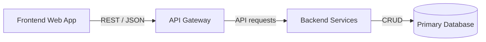

# Complex Mermaid

Follow `skill://uml-mcp-diagrams/SKILL.md`. Confirm Mermaid in the live catalog.
Build a component and directed-edge inventory before translating another format.
Use short stable IDs and quoted human labels; keep all relationships unless the
user explicitly narrows the view. Split large graphs into overview/detail views.

For sequences, put every participant, message, activation and control statement
on its own line. Balance `activate`/`deactivate` and `alt`/`end`. Validate with
`validate_uml(..., strict=true)` before rendering. Label yes/no decision branches;
use subgraphs for boundaries rather than duplicating nodes. Escape punctuation
inside labels instead of changing the architecture to satisfy the parser.

Use `generate_uml_image` with `diagram_type: mermaid`, `output_format: svg` for
MCP Apps. Kroki is the default service; a Mermaid request alone does not select
mermaid.ink. Use a catalog-supported theme and replace the previous theme when
re-rendering, avoiding conflicting init and frontmatter theme declarations.

Check readable labels and edge endpoints in the actual SVG. When only a compact
PNG is initially available, let the App retrieve full SVG rather than enlarging
the raster. Inspect the new result after changing format or theme. Use the
returned Mermaid Live playground link; never fabricate its encoded state.
In plain clients, provide one image and the returned links. In Apps, keep the
chat confirmation short and use the viewer's source and download controls.

State diagrams and mindmaps need explicit label checks. Mermaid may encode labels
as HTML-backed foreignObject elements. The server and viewer convert these to
inert SVG text for portability. Check label strings in the displayed result and
exported SVG/PNG; visible shapes without text fail acceptance.
