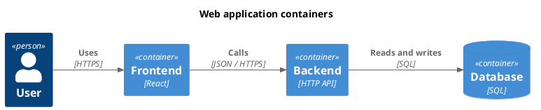

# PlantUML and C4

Follow `skill://uml-mcp-diagrams/SKILL.md`. Discover `c4plantuml` or the relevant
PlantUML type. Use Kroki first unless the user selects a different rendering
service. Maintain the same people, systems and directed relationships when
converting an existing architecture; do not invent a new architecture per format.

| Level | Scope | Source |
| --- | --- | --- |
| 1 | People and external systems | `!include <C4/C4_Context>` |
| 2 | Applications and data stores | `!include <C4/C4_Container>` |
| 3 | Components within one container | `!include <C4/C4_Component>` |
| 4 | Code inside one component | Ordinary UML class or sequence diagram |

There is no assumed `C4_Code` library. Level 4 is optional unless requested;
use real source evidence or label it as a proposed design. For full examples,
read `docs/diagrams/c4-views.md` in the repository.

Keep `@startuml` (including any optional diagram name) on its own line.
Use actual PlantUML themes such as `plain`, `cerulean` and `cyborg`. Put `!theme`
on a separate line; never use `!theme light` or append the diagram name to it.
Prefer standard-library includes to network include URLs.

Validate and then render each view as SVG. Check for renderer error pages,
missing text and invisible labels at all requested levels. A successful batch
response does not prove each item is usable. Inspect individual errors and
retry only failed views; retain successful ones. Copy only fresh returned links.
The PlantUML playground should be returned for C4 too, even with Kroki rendering.
Use the App's SVG download for sharp output; PNG export rasterizes the vector
with bundled fonts. Re-rendering PNG as SVG must update the active item without
losing its labels, source or other batch entries.
