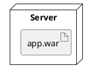
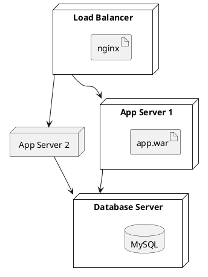

# deployment diagram (uml-mcp)

**`diagram_type`:** `deployment`  
**Backend:** `plantuml`  
**Output formats:** png, svg, pdf, txt, base64

Shows physical architecture of a system

Load the workflow skill [uml-mcp-diagrams](../uml-mcp-diagrams/SKILL.md) for URL-first replies, progressive discovery, and which MCP tool to call. This file is notation only; it does not add an MCP tool.

## Themes

Pass **`theme`** to `generate_uml` / `generate_uml_image` (PlantUML built-in name).
The server injects `!theme <name>` after `@startuml` when the source has no `!theme` yet.

Recommended: `cerulean`, `materia`, `sketchy`, `cyborg`, `plain`, `aws-orange`, `blueprint`, `sandstone`.

Match the **page background** (also see MCP prompt **`diagram_theme`**):
- light / white: `cerulean`, `materia`, `plain`, `sketchy`, `sandstone`
- dark / black: `blueprint`, `cyborg`, `black-knight`, `carbon-gray`, `crt-green`
- B&W / print: `plain`, `sketchy`, `sketchy-outline`, `mimeograph`, `lightgray`

Or embed in source:

```plantuml
@startuml
!theme cerulean
' … diagram …
@enduml
```

## Starter template



## Example



## Render with uml-mcp

1. Set `diagram_type` to `deployment` exactly.
2. Call **`validate_uml`** when the source is untrusted (prefer `strict: true` for Mermaid sequence).
3. Call **`generate_uml`**, **`generate_uml_image`** (chat PNG), or **`generate_uml_batch`**.
4. Pass **`theme`** when this skill's Themes section lists supported values.
5. Surface the returned `url` / `playground` (see the workflow skill).

Confirm formats with `uml://formats` or `list_diagram_types` when unsure.
