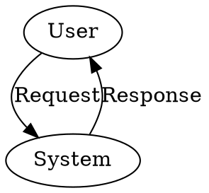
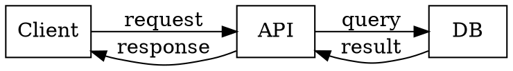

# graphviz diagram (uml-mcp)

**`diagram_type`:** `graphviz`  
**Backend:** `graphviz`  
**Output formats:** png, svg, pdf, jpeg

Graph visualization software

Load the workflow skill [uml-mcp-diagrams](../uml-mcp-diagrams/SKILL.md) for URL-first replies, progressive discovery, and which MCP tool to call. This file is notation only; it does not add an MCP tool.

## Styling

- Use `bgcolor`, `color`, `fillcolor`, `fontname`, `style=filled` on `graph`/`node`/`edge`.
- Example: `node [shape=box, style=filled, fillcolor="#E8F4FC"];`

## Starter template

## Example

## Render with uml-mcp

1. Set `diagram_type` to `graphviz` exactly.
2. Call **`validate_uml`** when the source is untrusted (prefer `strict: true` for Mermaid sequence).
3. Call **`generate_uml`**, **`generate_uml_image`** (chat PNG), or **`generate_uml_batch`**.
4. Pass **`theme`** when this skill's Themes section lists supported values.
5. Surface the returned `url` / `playground` (see the workflow skill).

Confirm formats with `uml://formats` or `list_diagram_types` when unsure.
