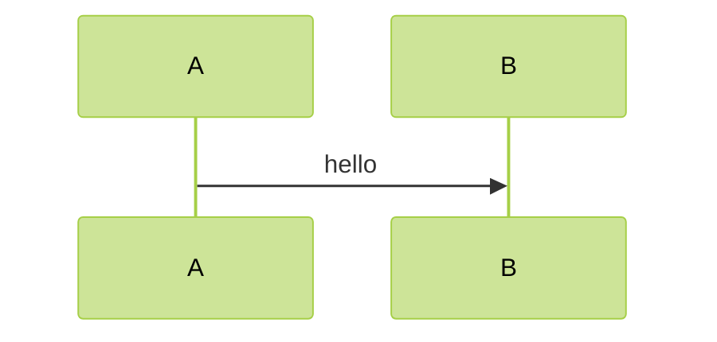
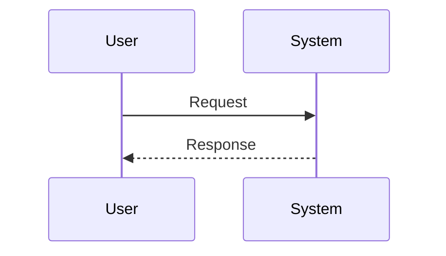
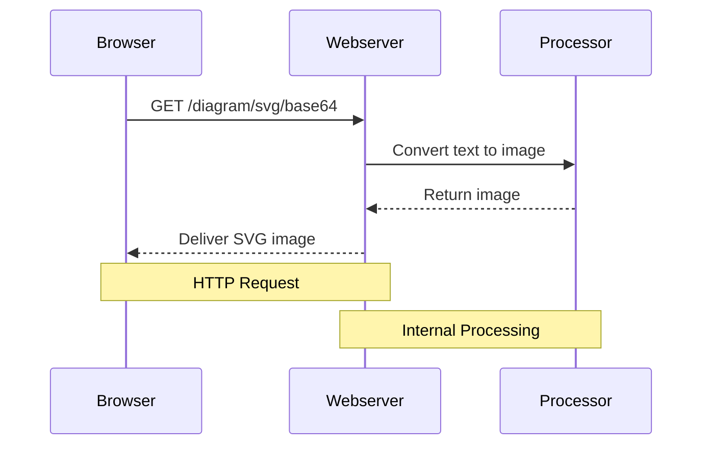

# mermaid diagram (uml-mcp)

**`diagram_type`:** `mermaid`  
**Backend:** `mermaid`  
**Output formats:** svg, png

A JavaScript based diagramming and charting tool

Load the workflow skill [uml-mcp-diagrams](../uml-mcp-diagrams/SKILL.md) for URL-first replies, progressive discovery, and which MCP tool to call. This file is notation only; it does not add an MCP tool.

## Notation tips

- Pick an opening kind: `flowchart`, `sequenceDiagram`, `classDiagram`, `stateDiagram-v2`, `erDiagram`, `gantt`, `pie`, `mindmap`.
- One statement per line for `sequenceDiagram` (no `;`-packed lines).
- API sequence: Client / API / optional Auth·DB with `alt` for errors.
- Gantt: `title`, `dateFormat`, sections, `after` dependencies.
- Class conversion: `classDiagram` with `<|--`, `*--`, `o--`, `-->`.

## Themes

Pass **`theme`** to `generate_uml` / `generate_uml_image`. Allowed values: `base`, `dark`, `default`, `forest`, `neutral`.
The server prepends `%%{init: {'theme': '<name>'}}%%` when the source has no init/frontmatter theme.

Match the **page background** (MCP prompt **`diagram_theme`**):
- light / white: `default`, `forest`, `neutral`, `base`
- dark / black: `dark`
- B&W / print: `neutral`, `base`, `default`

## Starter template

## Example

## Render with uml-mcp

1. Set `diagram_type` to `mermaid` exactly.
2. Call **`validate_uml`** when the source is untrusted (prefer `strict: true` for Mermaid sequence).
3. Call **`generate_uml`**, **`generate_uml_image`** (chat PNG), or **`generate_uml_batch`**.
4. Pass **`theme`** when this skill's Themes section lists supported values.
5. Surface the returned `url` / `playground` (see the workflow skill).

Confirm formats with `uml://formats` or `list_diagram_types` when unsure.
