<div align="center">


# UML-MCP

**Diagrams for AI assistants.** A [Model Context Protocol](https://modelcontextprotocol.io/) server
that turns a description or diagram source into a rendered diagram, inside the chat.

[](https://github.com/antoinebou12/uml-mcp/actions/workflows/test.yml)
[](https://antoinebou12.github.io/uml-mcp/)
[](https://github.com/antoinebou12/uml-mcp/releases)
[](LICENSE)
[](https://www.python.org/downloads/)
[](https://github.com/antoinebou12/uml-mcp/stargazers)
[](https://github.com/antoinebou12/uml-mcp/graphs/contributors)
[](https://github.com/antoinebou12/uml-mcp/commits/main)

[**Docs**](https://antoinebou12.github.io/uml-mcp/) ·
[**Quick start**](#quick-start) ·
[**Interactive diagrams**](#interactive-diagrams) ·
[**Changelog**](CHANGELOG.md) ·
[**Contributing**](CONTRIBUTING.md)

</div>

## It works as an MCP App

In clients that support MCP Apps, diagrams open in a viewer inside the chat
(`ui://uml-mcp/diagram-viewer`): zoom, edit the source, switch theme and format, re-render, step
through a batch, and export SVG, PNG, HTML or PDF. Clients without MCP Apps get the same diagram
as an inline PNG and SVG.

<p align="center">
  <a href="docs/assets/mcp-app-demo.mp4">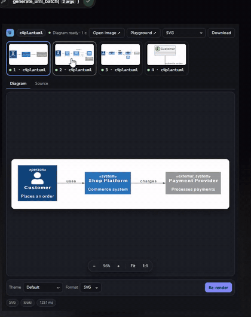</a>
</p>

<p align="center"><sub>One <code>generate_uml_batch</code> call returns four diagrams as tabs, then one is re-rendered in another format. <a href="docs/assets/mcp-app-demo.mp4">Full-quality video</a> · <a href="docs/integrations/mcp-app.md">more about the viewer</a>.</sub></p>

<p align="center">
  
</p>

<p align="center"><sub>In any other chat client: the inline image with links to the rendered file and an editable playground.</sub></p>

## Why UML-MCP

- **46 diagram types.** 37 through [Kroki](https://kroki.io/) (UML, Mermaid, D2, Graphviz, C4, BPMN,
  ERD, TikZ...) and 9 interactive ones: cloud and stack diagrams with real logos, archify-style
  architecture, workflow and sequence diagrams, and 2D/3D LLM visualisations.
- **Shows up in the chat.** Every client gets an inline image plus links to the rendered file and
  an editable playground. Clients with [MCP Apps](https://modelcontextprotocol.io/) also get an
  interactive viewer.
- **Ready to run.** Hosted endpoints, or local with Docker or Helm; optional Entra ID / OAuth 2.1
  SSO, audit logs and metrics. It scores 95/100 on the Manufact publishing checklist.

## Quick start

Add the hosted server to your MCP client:

```json
"uml-mcp": {
  "transport": "http",
  "url": "https://uml-mcp.vercel.app/mcp"
}
```

Then ask, for example, *"Draw a sequence diagram of a user logging in through an API gateway."*

| Endpoint | URL |
| --- | --- |
| Primary (Vercel) | `https://uml-mcp.vercel.app/mcp` |
| Mirror (Manufact) | `https://uml-mcp.antoineboucher.info/mcp` |

Ready-made configs: [Cursor](.cursor/mcp.json) · [VS Code / Copilot](.vscode/mcp.json) ·
[Codex](.codex/config.toml) · [Claude Desktop](config/) · [Open WebUI](config/openwebui_mcp.json) ·
[all clients](config/README.md). To run it yourself:

```bash
uv tool install uml-mcp && uml-mcp setup
```

The [installation guide](docs/installation.md) covers Docker, Helm and running from source.

## Interactive diagrams

The plugins below ship with UML-MCP and are on by default. Each type renders to an interactive HTML
page in the viewer and to a static SVG and PNG everywhere else.

| Plugin | Types | What you get |
| --- | --- | --- |
| [D3](docs/plugins/d3.md) | `d3_force` · `d3_architecture` · `d3_topology` | Force graphs and cloud diagrams with real provider and brand logos, routed with A\* |
| [Stack diagram](docs/plugins/stack-diagram.md) | `stack_diagram` | Icon tiles, nested vendor and region groups, numbered request steps |
| [Archify](docs/plugins/archify.md) | `archify_architecture` · `archify_workflow` · `archify_sequence` | Colour-coded groups, legend, three presets, click to focus and trace the shortest path |
| [LLM visualizer](docs/plugins/llm-visualizer.md) | `llm_2d` · `llm_3d` | Layer maps, autoencoder and GAN shapes, `N×` blocks and a rotatable 3D scene |
| [Database schema](docs/plugins/schema.md) | `db_schema` | ER diagrams from SQL DDL or JSON: column cards, crow's-foot keys at the column rows, search |
| [Dependency graphs](docs/plugins/deps.md) | `dependency_graph` | A project's dependency tree from `package.json`, `pyproject.toml`, `requirements.txt` or a lock file |
| [Statechart](docs/plugins/statechart.md) | `state_machine` | XState-like machines as statecharts, and a simulator that fires events, with a step log and Undo |
| [Agent traces](docs/plugins/trace.md) | `agent_trace` | An agent run as a waterfall and a flow: LLM, tool and retrieval steps with tokens, cost, retries and the critical path |
| [C4 model](docs/plugins/c4.md) | `c4_model` | One model, three C4 levels: click a system to open its containers, a container for its components |
| [Timeline](docs/plugins/timeline.md) | `timeline` | Roadmaps with swimlanes, phases, milestones, releases and dependency arrows; zoom from quarters to days |

Each image links to the plugin guide.

| | | |
| --- | --- | --- |
| [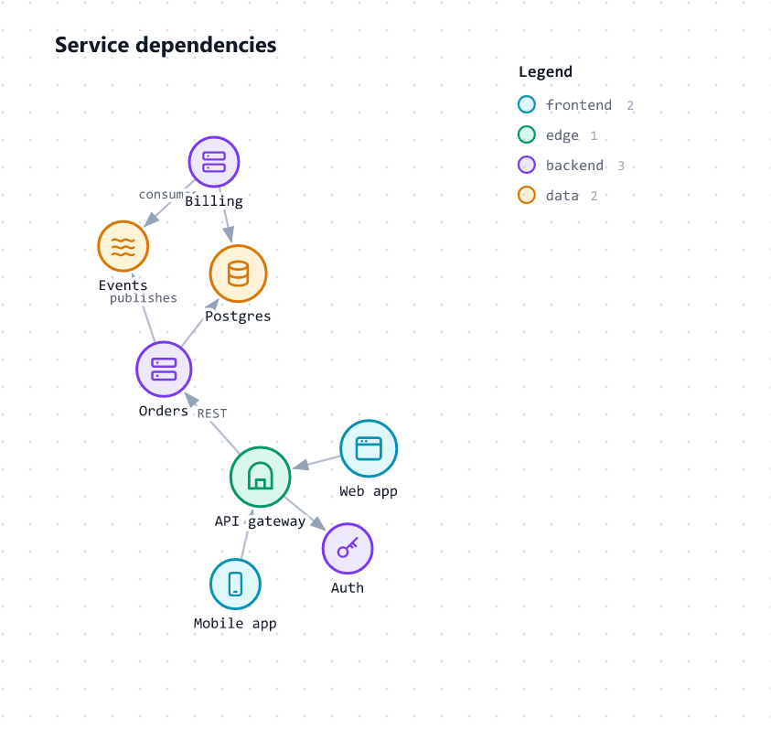](docs/plugins/d3.md)<br>`d3_force` | [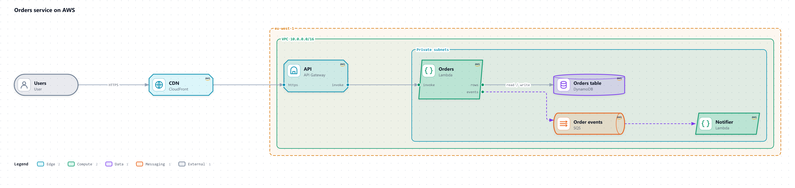](docs/plugins/d3.md)<br>`d3_architecture` | [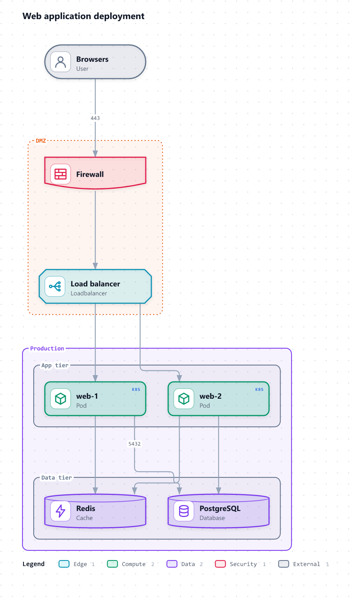](docs/plugins/d3.md)<br>`d3_topology` |
| [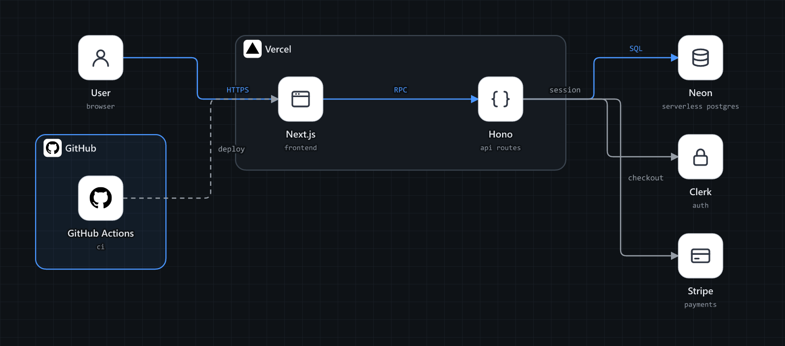](docs/plugins/stack-diagram.md)<br>`stack_diagram` | [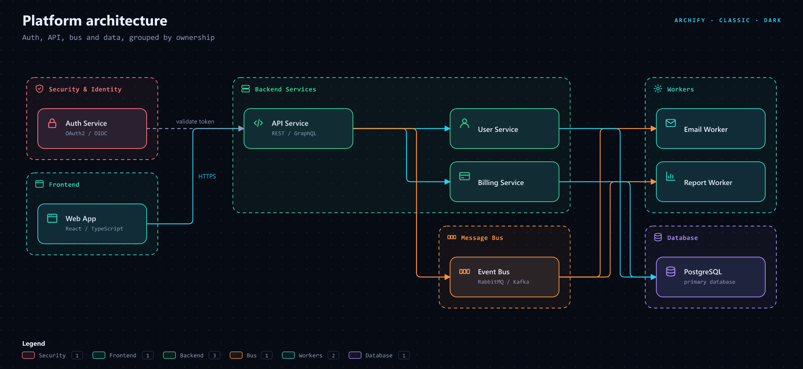](docs/plugins/archify.md)<br>`archify_architecture` | [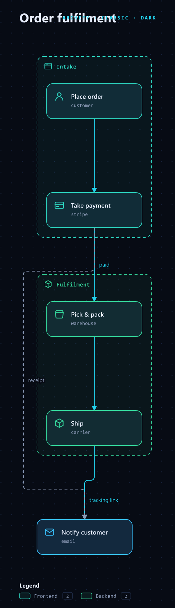](docs/plugins/archify.md)<br>`archify_workflow` |
| [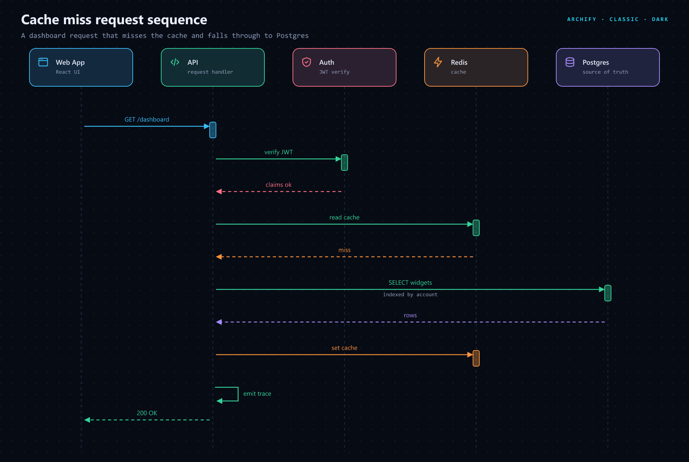](docs/plugins/archify.md)<br>`archify_sequence` | [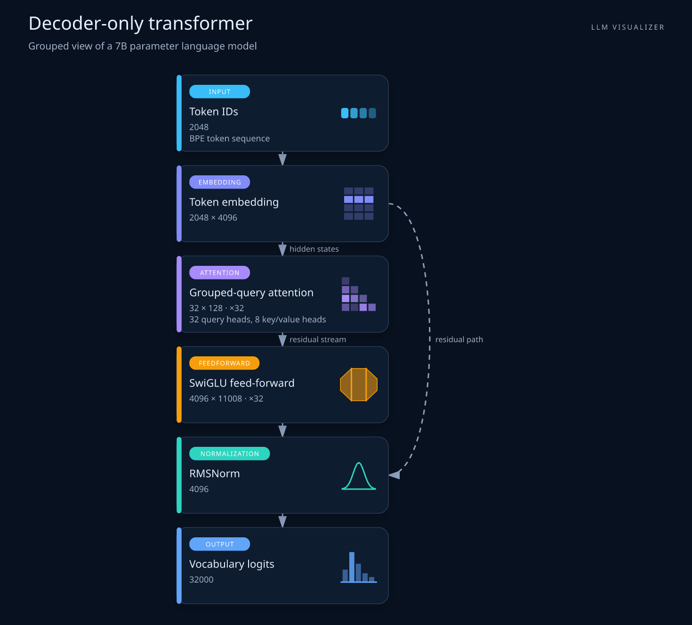](docs/plugins/llm-visualizer.md)<br>`llm_2d` | [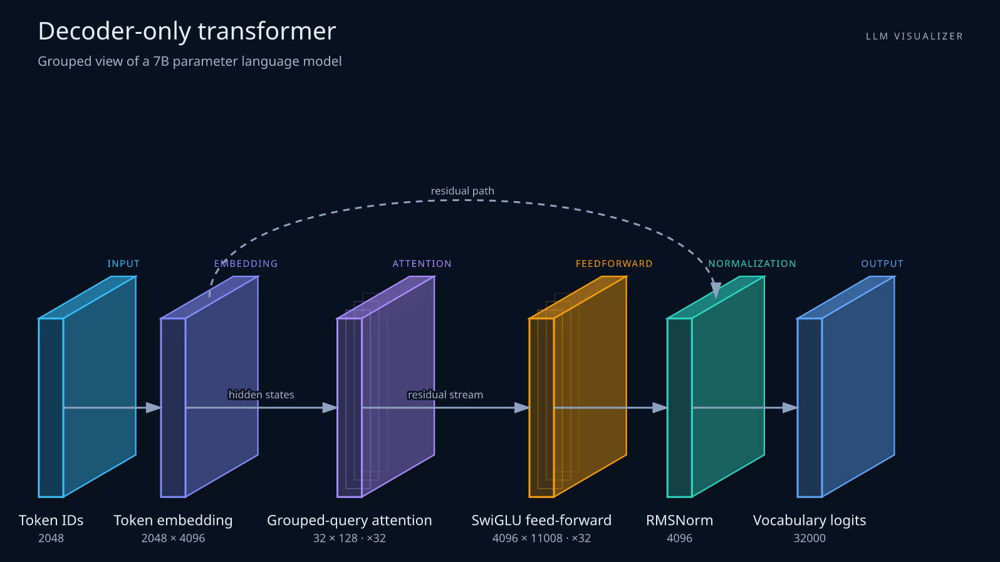](docs/plugins/llm-visualizer.md)<br>`llm_3d` |
| [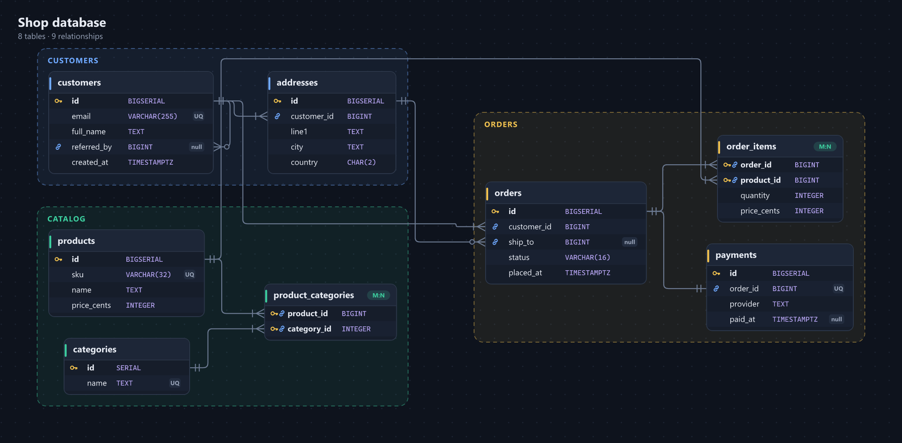](docs/plugins/schema.md)<br>`db_schema` | [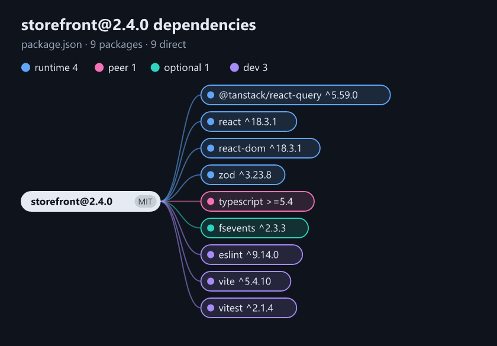](docs/plugins/deps.md)<br>`dependency_graph` | [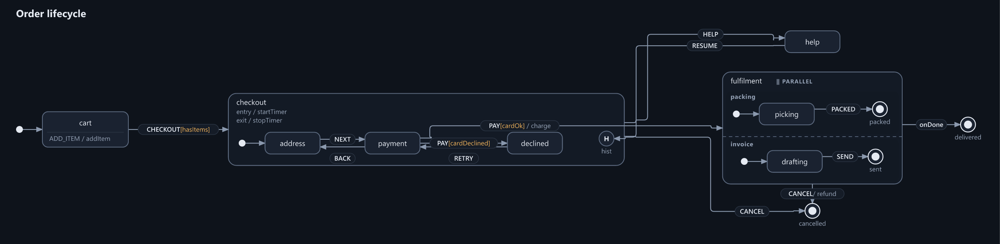](docs/plugins/statechart.md)<br>`state_machine` |
| [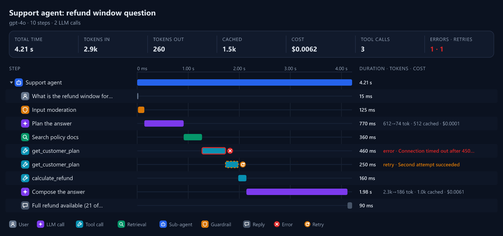](docs/plugins/trace.md)<br>`agent_trace` | [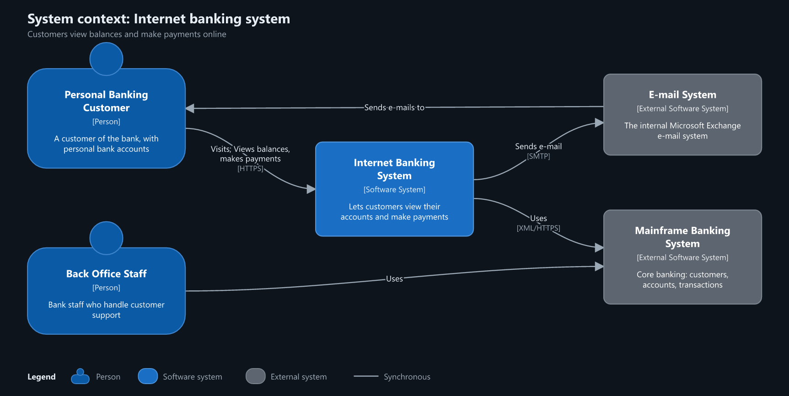](docs/plugins/c4.md)<br>`c4_model` | [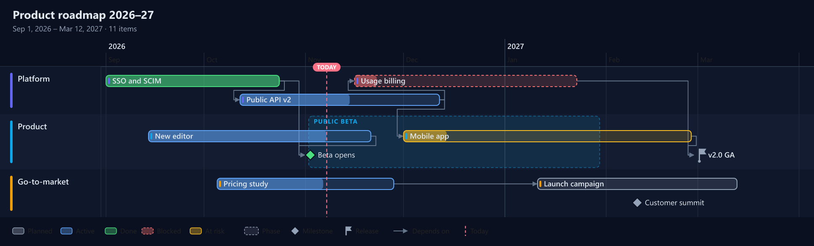](docs/plugins/timeline.md)<br>`timeline` |

```json
{
  "title": "SaaS stack",
  "groups": [{"id": "vercel", "name": "Vercel", "icon": "vercel"}],
  "nodes": [
    {"id": "user", "name": "User", "icon": "user"},
    {"id": "web", "name": "Next.js", "icon": "browser", "group": "vercel"},
    {"id": "db", "name": "Neon", "icon": "database"},
    {"id": "ci", "name": "GitHub Actions"}
  ],
  "edges": [
    {"from": "user", "to": "web", "label": "HTTPS", "step": 1},
    {"from": "web", "to": "db", "label": "SQL", "step": 2},
    {"from": "ci", "to": "web", "label": "deploy", "style": "dashed"}
  ]
}
```

Send that as `stack_diagram` and you get the GitHub and Vercel logos, two numbered steps and a
dashed deploy edge. The [plugins guide](docs/plugins/index.md) has example prompts for every type
and shows how to [write your own](docs/plugins/authoring.md).

## Tools

| Tool | Purpose |
| --- | --- |
| `generate_uml` | Render one diagram: image, URL and playground link |
| `generate_uml_image` | The same as an inline chat image (PNG by default) |
| `validate_uml` | Check source before rendering; errors say how to fix it |
| `list_diagram_types` | The live catalog, including plugin types |
| `generate_uml_batch` | Many diagrams in one call |

Resources (`uml://types`, `uml://examples`, `uml://templates`...), prompts and skills
(`skill://uml-mcp-diagrams/SKILL.md` plus focused guides) are listed in the
[reference](docs/reference/index.md).

## Documentation

| Topic | Where |
| --- | --- |
| Getting started and tutorials | [Tutorials](docs/tutorials/index.md) |
| Diagram types and notation | [Diagram types](docs/diagrams/index.md) |
| Clients, Docker, Helm, Vercel | [Deploy](docs/deploy/index.md) |
| MCP App viewer and publishing | [MCP App](docs/integrations/mcp-app.md) |
| Configuration (`uml-mcp.yaml`) | [Configuration](docs/configuration/uml-mcp-yaml.md) |
| Enterprise SSO, audit, metrics | [Enterprise](docs/enterprise/README.md) |
| Plugins | [Plugins](docs/plugins/index.md) |
| Admin console | [Admin](docs/admin/index.md) |

## Development

```bash
uv sync --all-groups
uv run pytest
uv run ruff check . && uv run ty check
uv run uml-mcp lint --strict --min-grade A
```

About 1,800 tests, including browser tests of every interactive page inside the MCP App viewer.
See [Testing](docs/testing.md) and [CONTRIBUTING.md](CONTRIBUTING.md).

## License

[MIT](LICENSE). Maintained by [Antoine Boucher](https://github.com/antoinebou12). Built on
[PlantUML](https://plantuml.com/), [Kroki](https://kroki.io/), [Mermaid](https://mermaid.js.org/),
[D2](https://d2lang.com/) and [D3](https://d3js.org/). Brand logos come from
[LobeHub Icons](https://github.com/lobehub/lobe-icons) (MIT) and remain trademarks of their owners.
