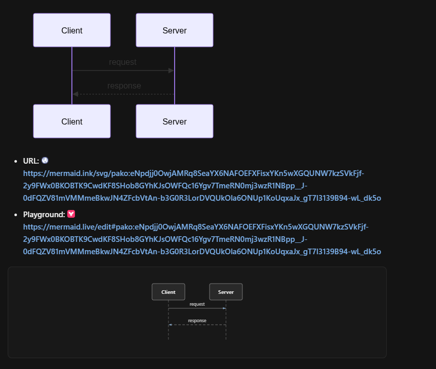
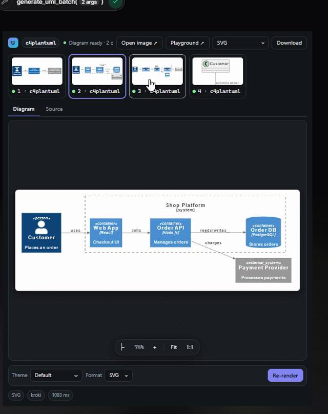
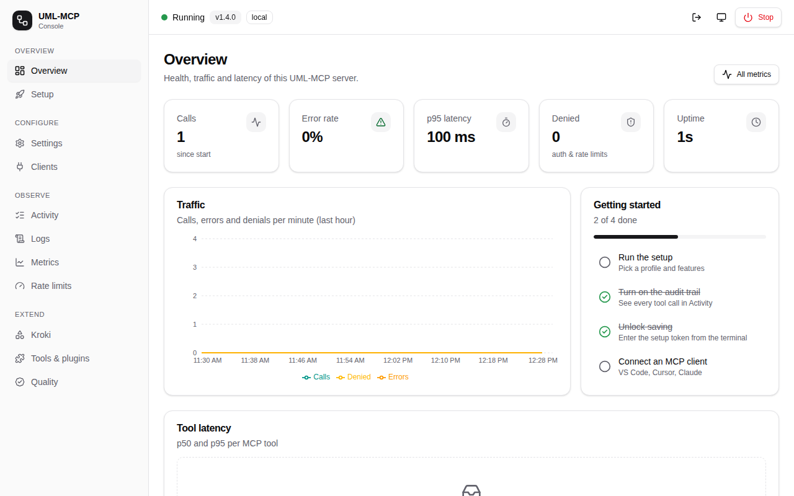
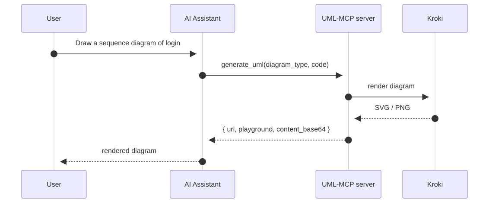

<div align="center">


# UML-MCP

**Diagrams for AI assistants.** A [Model Context Protocol](https://modelcontextprotocol.io/) server
that turns a description or diagram source into a rendered UML, Mermaid, D2, C4 or BPMN diagram,
or an interactive architecture, workflow, sequence or LLM diagram, right inside the chat.

[](https://github.com/antoinebou12/uml-mcp/actions/workflows/test.yml)
[](https://github.com/antoinebou12/uml-mcp/actions/workflows/build.yml)
[](https://github.com/antoinebou12/uml-mcp/actions/workflows/docs.yml)
[](LICENSE)
[](https://www.python.org/downloads/)
[](https://modelcontextprotocol.io/)

[](https://github.com/antoinebou12/uml-mcp/releases)
[](https://github.com/antoinebou12/uml-mcp/stargazers)
[](https://github.com/antoinebou12/uml-mcp/network/members)
[](https://github.com/antoinebou12/uml-mcp/graphs/contributors)
[](https://github.com/antoinebou12/uml-mcp/commits/main)
[](https://github.com/antoinebou12/uml-mcp/pulse)
[](https://github.com/antoinebou12/uml-mcp/issues)
[](https://github.com/astral-sh/ruff)
[](https://github.com/astral-sh/uv)

[**Hosted MCP**](https://uml-mcp.vercel.app/mcp) ·
[**Mirror**](https://uml-mcp.antoineboucher.info/mcp) ·
[**Docs**](https://antoinebou12.github.io/uml-mcp/) ·
[**Quick start**](#quick-start) ·
[**Plugins**](#interactive-and-custom-diagrams) ·
[**Changelog**](CHANGELOG.md) ·
[**Contributing**](CONTRIBUTING.md)

</div>

---

## Contents

- [Highlights](#highlights)
- [Endpoints](#endpoints)
- [It works as an MCP App](#it-works-as-an-mcp-app)
- [Quick start](#quick-start)
- [Interactive and custom diagrams](#interactive-and-custom-diagrams)
- [Capabilities](#capabilities)
- [Publishing readiness](#publishing-readiness)
- [Project stats](#project-stats)
- [Contributing](#contributing) · [License](#license)

## Highlights

- **46 diagram types out of the box:** 37 through [Kroki](https://kroki.io/) (UML, Mermaid, D2,
  Graphviz, C4, BPMN, ERD, TikZ, Excalidraw...) and 9 interactive ones from the bundled plugins.
- **Works in any MCP client.** Claude, ChatGPT, Cursor, VS Code / Copilot, Codex, Open WebUI. Chat
  clients get an inline PNG, a link to the rendered image and an editable playground link.
- **An MCP App viewer** (`ui://uml-mcp/diagram-viewer`) opens diagrams inside the chat: zoom, edit
  the source, switch theme and format, re-render, export SVG, PNG, HTML or PDF.
- **Interactive diagrams** that Kroki cannot draw: auto-laid-out cloud and stack diagrams with real
  logos, archify-style architecture, workflow and sequence diagrams, and 2D/3D LLM visualisations.
- **Production ready:** 95/100 on the Manufact publishing checklist, optional Microsoft Entra ID /
  OAuth 2.1 SSO, audit logs, Prometheus metrics, rate limits, Docker and Helm.
- **One config file** ([`uml-mcp.yaml`](docs/configuration/uml-mcp-yaml.md)), an admin console and
  a linter that grades the server's MCP surface and its connect-time token cost.

## Endpoints

Both endpoints serve the same tools, resources, prompts and skill over Streamable HTTP. Use either;
the mirror is there if one is down.

| Endpoint | URL | Hosting |
| --- | --- | --- |
| Primary | [`https://uml-mcp.vercel.app/mcp`](https://uml-mcp.vercel.app/mcp) | Vercel |
| Mirror | [`https://uml-mcp.antoineboucher.info/mcp`](https://uml-mcp.antoineboucher.info/mcp) | Manufact (custom domain); also the MCP App viewer origin |
| Docs | [antoinebou12.github.io/uml-mcp](https://antoinebou12.github.io/uml-mcp/) | GitHub Pages |

<p align="center">
  
</p>

<p align="center"><sub>A diagram preview with links to the rendered image and editable playground (mermaid.live).</sub></p>

## It works as an MCP App

In clients that support [MCP Apps](https://modelcontextprotocol.io/), a diagram opens in an interactive
viewer **inside the chat**: pan and zoom, view and edit the source, switch theme and format and
re-render, step through a batch, and download SVG, PNG, HTML or PDF. In the recording below, one
`generate_uml_batch` call returns four C4 and class diagrams as tabs, then re-renders one with a
different format.

<p align="center">
  <video src="https://github.com/antoinebou12/uml-mcp/raw/main/docs/assets/mcp-app-demo.mp4" poster="https://github.com/antoinebou12/uml-mcp/raw/main/docs/assets/mcp-app-demo.png" width="420" controls muted playsinline>
    <a href="docs/assets/mcp-app-demo.mp4"></a>
  </video>
</p>

<p align="center"><sub>Example recording (14 s): <a href="docs/assets/mcp-app-demo.mp4">docs/assets/mcp-app-demo.mp4</a>. The viewer is served as <code>ui://uml-mcp/diagram-viewer</code>.</sub></p>

Clients **without** MCP Apps still get the diagram: `generate_uml_image` returns an inline PNG,
`generate_uml` returns SVG, and the result carries image and playground links. Nothing in this
README needs MCP Apps to work.

## Quick start

### Connect to the hosted server

Add this to your MCP client, with the primary endpoint or the mirror:

```json
"uml-mcp": {
  "transport": "http",
  "url": "https://uml-mcp.vercel.app/mcp"
}
```

```json
"uml-mcp": {
  "transport": "http",
  "url": "https://uml-mcp.antoineboucher.info/mcp"
}
```

Then ask, for example, *"Draw a sequence diagram of a user logging in through an API gateway."*
You can also give PlantUML, Mermaid or other Kroki source directly.

| Client | Config | Guide |
| --- | --- | --- |
| Cursor | [`.cursor/mcp.json`](.cursor/mcp.json) | [docs/integrations/cursor.md](docs/integrations/cursor.md) |
| VS Code / Copilot | [`.vscode/mcp.json`](.vscode/mcp.json) | [docs/integrations/vscode_copilot.md](docs/integrations/vscode_copilot.md) |
| OpenAI Codex | [`.codex/config.toml`](.codex/config.toml) | [docs/integrations/openai_codex.md](docs/integrations/openai_codex.md) |
| Ollama / Open WebUI | [`config/openwebui_mcp.json`](config/openwebui_mcp.json) | [docs/integrations/ollama.md](docs/integrations/ollama.md) |
| Claude Desktop | [`config/claude_desktop_*.json`](config/) | [docs/integrations/claude_desktop.md](docs/integrations/claude_desktop.md) |

More client configurations: [`config/README.md`](config/README.md)

### Install locally

| Method | Command |
| --- | --- |
| Python installer (requires Python, typer and tqdm) | `python scripts/install.py` |
| Setup wizard | `uv tool install uml-mcp && uml-mcp setup` (profile, features, clients, health check) |
| Web setup form | `uml-mcp setup --web` opens the console setup page |
| Manual | `uml-mcp config init --profile local` · `uml-mcp client install --client vscode\|cursor\|claude-desktop\|claude-code` |

Guide: [docs/installation.md](docs/installation.md)

<p align="center">
  
</p>

<p align="center"><sub>The admin console (<code>uml-mcp admin</code>) includes setup, settings, activity, logs, metrics and plugins, with light and dark themes for desktop and mobile.</sub></p>

<details>
<summary><strong>Run from source (local stdio)</strong></summary>

```bash
git clone https://github.com/antoinebou12/uml-mcp.git
cd uml-mcp
uv sync
uv run python server.py
```

Configs: [`config/README.md`](config/README.md) (Cursor, VS Code, Codex, Claude, Open WebUI, Continue)

</details>

<details>
<summary><strong>Claude Code plugin</strong></summary>

```text
/plugin marketplace add https://github.com/antoinebou12/uml-mcp
/plugin install uml-mcp@uml-mcp-plugins
```

[docs/integrations/claude_code.md](docs/integrations/claude_code.md) · Cursor skill: [`.skill/skills/uml-mcp-diagrams/SKILL.md`](.skill/skills/uml-mcp-diagrams/SKILL.md)

</details>

## Interactive and custom diagrams

Plugins add **interactive** diagram types that Kroki cannot draw, and they are how you add
**custom** ones. Each type renders to a standalone **HTML** page, which the MCP App viewer shows
inside the chat, and to a static **SVG** (previewed as PNG) for clients without MCP Apps.

**All four bundled plugins are on by default.** They ship inside the `uml-mcp` package and load
without any configuration, on the hosted endpoints and on your own server. Set
`plugins.bundled: false` in `uml-mcp.yaml` for a strict allow-list. D3's extra `d3_catalog` tool
stays opt-in (`uml-mcp plugins enable d3`) because every tool adds connect-time tokens; the
renderers add none. `uml-mcp plugins list` shows what is installed and loaded.

| Plugin | Diagram types | Look |
| --- | --- | --- |
| [`d3`](docs/plugins/d3.md) | `d3_force` · `d3_architecture` · `d3_topology` | Force graphs and cloud boxes with real provider and brand logos, ports, A\*-routed edges |
| [`stack-diagram`](docs/plugins/stack-diagram.md) | `stack_diagram` | Icon tiles on engineered paper, nested vendor and region groups, labelled right-angled edges |
| [`archify`](docs/plugins/archify.md) | `archify_architecture` · `archify_workflow` · `archify_sequence` | Dashed colour-coded containers, icon cards, legend, `classic` / `blueprint` / `flow` presets, click-to-focus and shortest path |
| [`llm-visualizer`](docs/plugins/llm-visualizer.md) | `llm_2d` · `llm_3d` | Layer maps and a rotatable 3D scene; autoencoder and GAN shapes, grouped `N×` blocks |

`stack-diagram` and `archify` share one auto-layout engine:

| Option | Values | Notes |
| --- | --- | --- |
| `direction` | `LR` · `RL` · `TB` · `BT` | Left to right, right to left, top down, bottom up. `LR` by default; `archify_workflow` starts top down |
| `theme` | `auto` · `dark` · `light` | `auto` (the default) follows the system in HTML and is dark in static output. The viewer's theme picker sets it for every plugin |
| `groups` | nested, `parent` | A group box always encloses exactly its members; nodes are packed so a pipeline stays on one line |
| `icon` | brand, glyph or data URI | Real logos for 28 brands (GitHub, Vercel, Cloudflare, AWS, Azure, Google Cloud, OpenAI, Claude, Gemini, LangChain...), also guessed from a node's name; 25 line glyphs; or your own image |

```json
{
  "title": "SaaS stack", "direction": "LR", "theme": "auto",
  "groups": [{"id": "vercel", "name": "Vercel", "icon": "vercel"}],
  "nodes": [
    {"id": "user", "name": "User", "role": "browser", "icon": "user"},
    {"id": "web", "name": "Next.js", "role": "frontend", "icon": "browser", "group": "vercel"},
    {"id": "db", "name": "Neon", "role": "postgres", "icon": "database"},
    {"id": "ci", "name": "GitHub Actions", "role": "ci"}
  ],
  "edges": [
    {"from": "user", "to": "web", "label": "HTTPS"},
    {"from": "web", "to": "db", "label": "SQL"},
    {"from": "ci", "to": "web", "label": "deploy", "style": "dashed"}
  ]
}
```

**Try these prompts** (`list_diagram_types` lists every type):

| Ask | Type used |
| --- | --- |
| *"Draw my stack: Next.js and Hono on Vercel, Neon Postgres, Clerk for auth, Stripe for payments. Left to right, light theme."* | `stack_diagram` |
| *"Show our platform as an archify architecture with security, backend and database groups, blueprint preset."* | `archify_architecture` |
| *"Sequence diagram of a cache-miss request through web, API, auth, Redis and Postgres."* | `archify_sequence` |
| *"Our AI app: Cloudflare in front of a Vercel app, a LangChain agent calling Claude, OpenAI and Gemini."* | `d3_architecture` |
| *"Draw an autoencoder top-down, then the same model as a 3D scene."* | `llm_2d` · `llm_3d` |
| *"A transformer with encoder and decoder blocks repeated 6 times."* | `llm_2d` with groups |

**Write your own:** a plugin is a small Python package with a `uml_mcp.renderers` entry point, a
JSON source format, `html` and `svg` outputs and an example per type. The four plugins above are
working references. See the [plugin author guide](docs/plugins/authoring.md); a custom type then
appears in `list_diagram_types`, `uml://examples`, the MCP App viewer's theme picker and batch
tools with no further wiring.

## Capabilities

Compatible clients discover the diagram workflow with `skills/list` and load
`skill://uml-mcp-diagrams/SKILL.md` through `resources/read`. Notation for each diagram type is in
`.skill/skills/<diagram_type>/SKILL.md` via the [agent-skills index](docs/reference/resources.md#per-type-agent-skills).
See [Skills over MCP](docs/reference/resources.md#diagram-skill-over-mcp).

| Capability | Details |
| --- | --- |
| Diagrams | 37 types via [Kroki](https://kroki.io/) (UML, Mermaid, D2, TikZ, BPMN, C4, GoAT, UMLet...) + 9 interactive plugin types |
| Tools | `generate_uml` · `generate_uml_image` · `validate_uml` · `list_diagram_types` · `generate_uml_batch`, plus two viewer-only helpers |
| Chat | Inline PNG + markdown `` + Playground link |
| MCP App | `ui://uml-mcp/diagram-viewer`: zoom, edit, re-render, theme and format pickers, export |
| Deploy | Local · Docker · Kubernetes ([Helm](deploy/helm/uml-mcp)) · [Vercel](https://vercel.com/) |
| Enterprise | Optional SSO: Microsoft Entra ID / OAuth 2.1 bearer tokens, RFC 9728 metadata, clear 401/403 ([docs/enterprise](docs/enterprise/README.md) · [guide](docs/enterprise/enterprise-guide.md)) |
| Config file | One [`uml-mcp.yaml`](docs/configuration/uml-mcp-yaml.md) (defaults < file < env) · `uml-mcp config init\|show\|validate` · profiles `local` / `docker` / `enterprise` |
| Audit & observability | MXCP-style audit of every tool/resource/prompt call (JSONL rotation, stdout → SIEM) · JSON logs · metrics + Prometheus `/metrics` · rate limits per IP/user/route/tool ([operations](docs/enterprise/operations.md)) |
| Quality | `uml-mcp lint --strict --min-grade A`: mcpx-style grade, token budget, MXCP-style config checks ([rules](docs/developers/linting.md)) |
| Admin console | Setup form, schema-driven settings (save, reset, live apply), activity, live logs, charts, Kroki playground and Docker stack, Stop; local token or `MCP.Admin` ([tour](docs/admin/index.md)) |
| Local Kroki | `uml-mcp kroki up --use`: Kroki + mermaid, blockdiag, bpmn, excalidraw in Docker on `127.0.0.1` ([guide](docs/admin/install.md#4-run-kroki-with-every-companion-docker)) |
| Plugins | Diagram renderers and tools from Python packages ([guide](docs/plugins/index.md) · [author](docs/plugins/authoring.md)); four bundled and on by default |
| Tracing | Optional OpenTelemetry spans per request and MCP call (`uml-mcp[otel]`) |
| Frontend | Canonical AG-UI SSE for agent UIs; OpenUI can consume AG-UI and render generated components in your app |

<details>
<summary><strong>MCP tools</strong></summary>

| Tool | Purpose |
| --- | --- |
| `generate_uml` | Render one diagram; tool text includes image markdown, URL, Playground. Use `png` for ImageContent. |
| `generate_uml_image` | Inline chat image (default PNG); fetches bytes even under hosted `MCP_URL_ONLY` |
| `validate_uml` | Local checks; `strict` for Mermaid/D2 (rejects semicolon-packed `sequenceDiagram`) |
| `list_diagram_types` | Catalog (like `uml://types`) |
| `generate_uml_batch` | Many diagrams (`MCP_BATCH_MAX_ITEMS`, `MCP_BATCH_CONCURRENCY`) |
| `rerender_diagram` · `download_diagram` | Viewer-only (hidden from the model): re-render with a new theme or format, and export files |

Smoke prompts: [`tests/prompts/chatgpt_mcp_smoke_test.md`](tests/prompts/chatgpt_mcp_smoke_test.md)

</details>

<details>
<summary><strong>Resources (<code>uml://</code> and <code>ui://</code>)</strong></summary>

| Resource | Description |
| --- | --- |
| `uml://types` | Types, backends, formats |
| `uml://templates` / `uml://examples` | Starters and samples |
| `uml://formats` / `uml://capabilities` | Formats and validation matrix |
| `uml://server-info` / `uml://workflow` | Version/tools and plan-then-generate |
| `ui://uml-mcp/diagram-viewer` | The MCP App viewer (`text/html;profile=mcp-app`) |
| `skill://uml-mcp-diagrams/SKILL.md` | Diagram workflow skill (MCP Skills / `resources/read`) |

</details>

<details>
<summary><strong>Diagram types</strong></summary>

| Category | Examples |
| --- | --- |
| UML | Class, Sequence, Activity, Use Case, State, Component, Deployment, Object |
| General | Mermaid, D2, Graphviz, ERD, BlockDiag, BPMN, C4 |
| Specialized | TikZ, Excalidraw, GoAT, UMLet, Nomnoml, Pikchr, Structurizr, SVGBob, WaveDrom, WireViz, ... |
| Interactive (plugins) | D3 force, architecture and topology · stack diagrams · archify architecture, workflow and sequence · LLM 2D and 3D |

[docs/diagrams/index.md](docs/diagrams/index.md)

</details>

<details>
<summary><strong>Remote vs local</strong></summary>

| | Remote (hosted) | Local |
| --- | --- | --- |
| Transport | HTTP MCP | stdio or HTTP |
| File writes | No | Optional |
| Chat images | PNG tools fetch bytes under URL-only | Same + optional disk |
| Env | Server-side | Your `.env` |

</details>

<details>
<summary><strong>Deployment</strong></summary>

For Vercel, connect the repository and configure clients to use `https://<project>.vercel.app/mcp`.

Docker:

```bash
docker compose up -d
docker build -t uml-mcp . && docker run -p 8000:8000 uml-mcp
docker run -i uml-mcp python server.py --transport stdio
# self-hosted PlantUML + mermaid.ink fallbacks next to local Kroki
MCP_DIAGRAM_FALLBACK=true USE_LOCAL_PLANTUML=true USE_LOCAL_MERMAID_INK=true docker compose --profile fallback up -d
```

[docs/deploy/docker.md](docs/deploy/docker.md)

Kubernetes with SSO: `helm upgrade --install uml-mcp deploy/helm/uml-mcp --set auth.mode=jwt …` (Entra ID or any OIDC provider); add `--set kroki.enabled=true --set plantuml.enabled=true --set mermaidInk.enabled=true` to run the renderers in-cluster. Guide: [docs/enterprise](docs/enterprise/README.md).

</details>

<details>
<summary><strong>Configuration (local)</strong></summary>

| Variable | Default |
| --- | --- |
| `KROKI_SERVER` | `https://kroki.io` |
| `PLANTUML_SERVER` | `http://plantuml-server:8080` |
| `MERMAID_INK_SERVER` | `https://mermaid.ink` |
| `MCP_OUTPUT_DIR` | `./output` |
| `MCP_READ_ONLY` | `false` |
| `MCP_URL_ONLY` | see [docs/configuration.md](docs/configuration.md) |
| `MCP_BATCH_MAX_ITEMS` | `20` |
| `MCP_BATCH_CONCURRENCY` | `4` |
| `MCP_RATE_LIMIT_PER_MINUTE` | `0` |
| `UML_MCP_CONFIG` | discovered `uml-mcp.yaml` (`none` disables) |
| `ADMIN_EMAIL` | unset (hosted `/admin` login off), see [docs/admin/hosted-vercel.md](docs/admin/hosted-vercel.md) |
| `ADMIN_PASSWORD_HASH` / `ADMIN_PASSWORD` | unset; the hash is preferred |
| `ADMIN_SESSION_SECRET` | unset; at least 32 characters, required for the login |

All configuration options: [docs/configuration.md](docs/configuration.md) · single file: [docs/configuration/uml-mcp-yaml.md](docs/configuration/uml-mcp-yaml.md)

</details>

<details>
<summary><strong>Architecture and layout</strong></summary>

Assistant → `generate_uml` / `generate_uml_image` → Kroki (+ fallbacks) or a plugin renderer → `url`, `playground`, optional image bytes.

<p align="center">
  
</p>

```text
server.py / app.py     -- MCP + FastAPI (/mcp)
mcp_core/tools/        -- generate_uml, generate_uml_image, validate, batch
mcp_core/apps/         -- the MCP App viewer (ui://uml-mcp/diagram-viewer)
mcp_core/plugins/      -- plugin discovery, loading and routing
tools/kroki/           -- Kroki, PlantUML, Mermaid, D2
examples/plugins/      -- d3, stack-diagram, archify, llm-visualizer (bundled) and hello (minimal)
```

AG-UI clients use `POST /ag-ui`. The legacy direct-render endpoint is `POST /ag-ui/generate`. See [frontend integration](docs/integrations/frontend.md) and [OpenUI + UML-MCP](docs/integrations/openui.md).

</details>

<details>
<summary><strong>Enterprise SSO: OAuth 2.1 · OpenID Connect · Microsoft Entra ID</strong></summary>

Enterprise SSO is optional and disabled by default (`MCP_AUTH_MODE=none`). The public hosted endpoints are open.

| Topic | Summary |
| --- | --- |
| Modes | `jwt`: validate Entra / OIDC access tokens (resource server) · `entra-proxy`: adds RFC 8414 + RFC 7591 facade with S256-only PKCE for DCR clients |
| OAuth 2.1 | Authorization Code + PKCE S256; header-only bearer tokens; 401 → `WWW-Authenticate: Bearer resource_metadata, scope`; 403 `insufficient_scope` step-up |
| OpenID Connect | Discovery + JWKS for signing keys; ID tokens are rejected, access tokens only |
| Entra ID | v2 tokens (`requestedAccessTokenVersion: 2`), `mcp.read` / `mcp.write` / `.default`, app roles, VS Code + Visual Studio pre-authorized ([setup](docs/enterprise/entra-id.md)) |
| MSAL | Client side only (VS Code, Visual Studio, Azure CLI, daemons); examples in [OAuth/OIDC/MSAL](docs/enterprise/oauth-oidc.md) |
| Try it | [`tests/http/entra-auth.http`](tests/http/entra-auth.http) · `python -m mcp_core.auth generate az-script` · [checklist](docs/enterprise/checklist.md) |

</details>

## Publishing readiness

The mirror (`https://uml-mcp.antoineboucher.info/mcp`) was checked with the
[Manufact](https://manufact.com) publishing checklist on October 30, 2026: **95/100**, 30 checks
passed and 1 warning, ready for ChatGPT and Claude.

| Area | Result | What was checked |
| --- | --- | --- |
| Protocol | 4/4 | MCP negotiation (v1 and v2), `tools/list` (7 tools), `resources/list` (10 resources), tools capability |
| Tools | 12/12 | Descriptions and titles, name length and characters, OpenAI behaviour hints, input and output schemas, readable tool-linked `ui://` resource, invocation metadata |
| MCP Apps | 6/7 | `ui://uml-mcp/diagram-viewer` is readable as `text/html;profile=mcp-app`, declares one HTTPS domain, CSP covers every external origin, no nested iframes. The warning asked for a view description in `_meta`; the resource now also sends `_meta["openai/widgetDescription"]`, to be confirmed on the next run |
| Client compatibility | 8/8 | Skills over MCP, Claude Code 2 KB fields, Claude 64-character names and behaviour hints, Cursor name budget, ChatGPT unique names, file parameter schemas |
| Policy review | partial | The platform's review agent did not finish; it is a platform step, not a server setting |

Details and the deployment notes are in [MCP Apps compatibility](docs/integrations/manufact-compatibility.md).

## Project stats

| | |
| --- | --- |
| Diagram types | 46 (37 Kroki-backed, 9 interactive plugin types) |
| MCP surface | 5 model tools + 2 viewer helpers · 10 resources · 5 prompts · 1 skill |
| Bundled plugins | 4, on by default (d3, stack-diagram, archify, llm-visualizer) |
| Brand logos | 28, MIT-licensed, drawn offline |
| Tests | About 1,700, plus browser tests of every interactive page in the MCP App viewer |
| Publishing checklist | 95/100 (Manufact) |
| Python | 3.12 to 3.15 |

[](https://github.com/antoinebou12/uml-mcp/stargazers)
[](https://github.com/antoinebou12/uml-mcp/network/members)
[](https://github.com/antoinebou12/uml-mcp/watchers)
[](https://github.com/antoinebou12/uml-mcp)
[](https://github.com/antoinebou12/uml-mcp/pulls)
[](https://github.com/antoinebou12/uml-mcp/pulls?q=is%3Apr+is%3Aclosed)
[](https://mseep.ai/app/antoinebou12-uml-mcp)

Daily and monthly activity (stars, forks, merged PRs, issues): [trendshift.io/repositories/42725](https://trendshift.io/repositories/42725)

> If this survives a real production repo, it beats a lot of polished launch demos.
>
> [@AIDailyGems](https://x.com/AIDailyGems/status/2060894196777509037)

## Development

```bash
uv sync --all-groups
uv run pytest tests/ -v
uv run ruff check . && uv run ruff format --check .
uv run ty check
uv run uml-mcp lint --strict --min-grade A
make ci
```

Serve the documentation locally with `uv run mkdocs serve`, then open http://127.0.0.1:8000.

## Contributing

Contributions are welcome: bug reports, new diagram types, plugins, client guides and docs.
Read [CONTRIBUTING.md](CONTRIBUTING.md) and the [Code of Conduct](CODE_OF_CONDUCT.md), and report
security issues privately as described in [SECURITY.md](SECURITY.md).

| Resource | Links |
| --- | --- |
| Docs | [Site](https://antoinebou12.github.io/uml-mcp/) · [Cursor](docs/integrations/cursor.md) · [Claude Code](docs/integrations/claude_code.md) · [Frontend](docs/integrations/frontend.md) · [Enterprise SSO](docs/enterprise/README.md) · [OpenUI](docs/integrations/openui.md) |
| Releases | [CHANGELOG.md](CHANGELOG.md) · [GitHub releases](https://github.com/antoinebou12/uml-mcp/releases) |
| Plugins | [Overview](docs/plugins/index.md) · [Author guide](docs/plugins/authoring.md) |

## License

[MIT](LICENSE). Maintained by [Antoine Boucher](https://github.com/antoinebou12).

Built on [PlantUML](https://plantuml.com/), [Kroki](https://kroki.io/), [Mermaid](https://mermaid.js.org/),
[D2](https://d2lang.com/) and [D3](https://d3js.org/). Brand logos come from
[LobeHub Icons](https://github.com/lobehub/lobe-icons) (MIT); they are trademarks of their owners
and do not imply endorsement.
