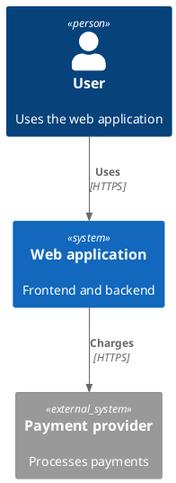
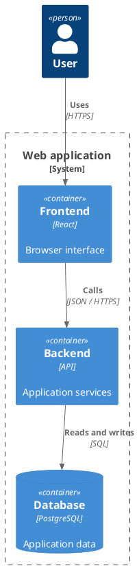
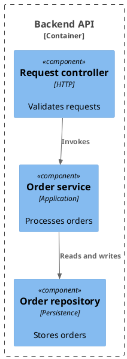
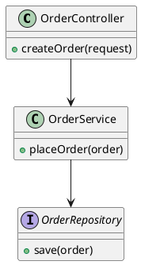

# C4 views in the MCP App

Use Kroki with `output_format: "svg"` for sharp labels in the viewer. The first
response carries bounded previews; selecting a view loads its full vector.
PNG and PDF are file exports. SVG is the default App preview. Source and
standalone HTML downloads are also available.

## Level 1: system context

Use `diagram_type: "c4plantuml"`:

## Level 2: containers

Use `diagram_type: "c4plantuml"`:

## Level 3: components

Use `diagram_type: "c4plantuml"`:

## Level 4: code

Use a normal UML class view, `diagram_type: "class"`. There is no separate
`C4_Code` library to include:

For a gallery, put these four sources in `generate_uml_batch.items`, with SVG
selected on each item. Keep `user_intent` outside the item renderer arguments.
Use a real PlantUML theme such as `plain`, `cerulean` or `cyborg`; `light` is a
background preference, not a PlantUML theme name. Leave the theme unset for
the standard C4 palette.
