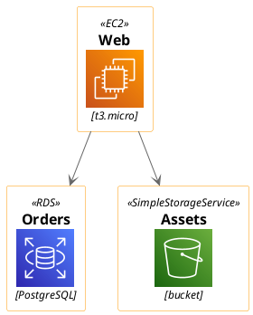
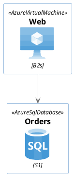
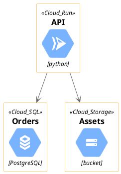
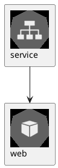
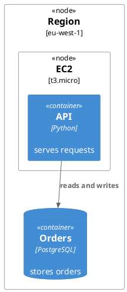

# Cloud architecture diagrams

There are three good ways to draw a cloud architecture with UML-MCP. Pick by what you need:

| You need | Use | `diagram_type` | Output |
| --- | --- | --- | --- |
| **Official** AWS, Azure or Google Cloud icons | PlantUML icon libraries (below) | `plantuml` | `svg`, `png`, `pdf` |
| A deployment view: nodes, containers, databases | C4 deployment (below) | `plantuml` | `svg`, `png`, `pdf` |
| An **interactive** diagram: zoom, pan, drag boxes, nested groups, named input and output ports | The [D3 plugin](../plugins/d3.md) | `d3_architecture`, `d3_topology` | `html`, `svg` |

The PlantUML libraries are bundled with PlantUML, so the `<...>` includes resolve when Kroki
renders and these diagrams need no extra setup beyond a Kroki server. Send the source with
`generate_uml` and `diagram_type: plantuml`.

!!! warning "Include names must be exact"

    A wrong include name is the usual failure, and it is reported as
    `cannot include <gcp/Compute/ComputeEngine>`. The examples on this page all render; the macro
    names follow the include file names, so Google Cloud uses `Compute_Engine`, not
    `ComputeEngine`. Not every service has an include, so when Kroki reports
    `cannot include <...>`, check the file name.

## AWS



Each service is one include and one macro: `!include <awslib/Compute/Lambda>` gives `Lambda(...)`, and
`!include <awslib/NetworkingContentDelivery/ElasticLoadBalancing>` gives `ElasticLoadBalancing(...)`.
The macro takes an alias, a label and a description.

## Azure



## Google Cloud



Other includes that exist: `gcp/Compute/Compute_Engine`, `gcp/Compute/Kubernetes_Engine`,
`gcp/Compute/Cloud_Functions` and `gcp/Networking/Cloud_Load_Balancing`.

## Kubernetes



## Deployment view with C4



C4 draws boxes and labels, not vendor icons. See [C4 (PlantUML)](c4plantuml.md) for the rest of
the C4 macros.

## Interactive diagrams

For a diagram you can explore, use the [D3 plugin](../plugins/d3.md). It draws the same kinds of
architecture, with nested groups (region, VPC, subnet), named ports and arrows routed around the
boxes, and renders to an HTML page or an SVG with no Kroki call:

```json
{
  "provider": "aws",
  "nodes": [
    {"id": "web", "service": "aws:ec2"},
    {"id": "db", "service": "aws:rds"}
  ],
  "links": [{"from": "web", "to": "db"}]
}
```

Its icons are original glyphs in the colour of each node's category, with a provider badge, a
monogram tile for popular software (`postgres`, `kafka`, `redis` and more), or a `logo` you supply.
They are not the vendors' artwork. Use the PlantUML libraries above when the official icons are
required.

## Related

- [UML (PlantUML)](uml.md) and [C4 (PlantUML)](c4plantuml.md)
- [D3 diagrams plugin](../plugins/d3.md)
- [Diagram types](index.md)
