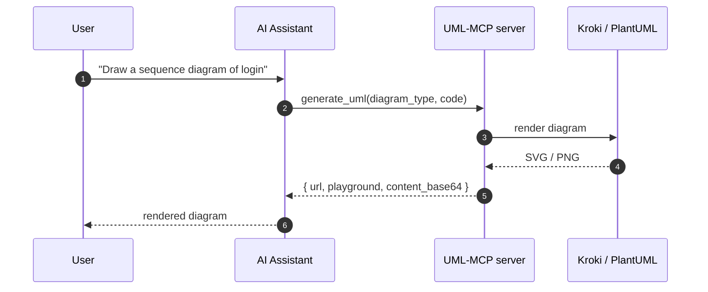

# UML-MCP

UML-MCP renders diagrams from source supplied by an AI assistant. It supports 52 diagram
types: 37 through Kroki and 15 interactive types from ten bundled plugins. Clients receive
an inline image or a rendered file; clients with MCP Apps also open an interactive
[viewer](integrations/mcp-app.md) inside the chat.

The bundled plugins render locally. They cover architecture, workflows, LLM layers,
database schemas, dependency graphs, statecharts, agent traces, C4 models and timelines.
[Browse the illustrated plugin catalog](plugins/index.md#interactive-diagram-gallery) or
[try the local viewer](integrations/mcp-app.md#local-viewer-preview).

For product UIs, UML-MCP can stay focused on diagrams while the rest of the stack does its own job: **MCP** exposes tools to the agent, **AG-UI** streams agent events to the frontend, and **OpenUI** can turn model output into interactive components owned by your application.

[](https://github.com/antoinebou12/uml-mcp/actions/workflows/test.yml)
[](https://github.com/antoinebou12/uml-mcp/actions/workflows/build.yml)
[](https://github.com/antoinebou12/uml-mcp/actions/workflows/docs.yml)
[](https://github.com/antoinebou12/uml-mcp/stargazers)
[](https://opensource.org/licenses/MIT)
[](https://www.python.org/downloads/)



[Get started in 5 minutes :material-rocket-launch:](tutorials/getting-started.md){ .md-button .md-button--primary }
[Browse the API reference :material-book-open-variant:](reference/index.md){ .md-button }
[Add to Cursor / Claude :material-puzzle:](deploy/index.md){ .md-button }
[Try the local viewer](integrations/mcp-app.md#local-viewer-preview){ .md-button }

---

## Features

<div class="grid cards" markdown>

-   :material-shape-plus:{ .lg .middle } **52 diagram types**

    ---

    UML (Class, Sequence, Activity, Use Case, State, Component, Deployment, Object), Mermaid, D2, Graphviz, TikZ, ERD, BlockDiag, BPMN, C4 and more, all in one tool call.

    [:octicons-arrow-right-24: Diagram catalog](diagrams/index.md)

-   :material-application-outline:{ .lg .middle } **MCP App viewer**

    ---

    In clients with MCP Apps, diagrams open inside the chat: zoom, edit the source, switch theme and format, re-render and export SVG, PNG, HTML or PDF. Other clients get an inline PNG and SVG.

    [:octicons-arrow-right-24: MCP App viewer](integrations/mcp-app.md)

-   :material-graph-outline:{ .lg .middle } **Interactive diagrams**

    ---

    Ten bundled plugins, on by default: architecture and stack diagrams, LLM layers, database schemas, dependency graphs, statecharts, agent traces, C4 drill-down and timelines. Each type has an interactive HTML page and static SVG/PNG output.

    [:octicons-arrow-right-24: Plugins](plugins/index.md)

-   :material-tools:{ .lg .middle } **MCP-native tools**

    ---

    `generate_uml`, `generate_uml_image` (inline PNG/SVG for chat clients), `validate_uml`, `list_diagram_types`, and `generate_uml_batch` are MCP tools with annotations (`readOnlyHint`, `idempotentHint`, etc.) and resource URIs under `uml://`.

    [:octicons-arrow-right-24: Tool reference](api/tools.md)

-   :material-view-dashboard-outline:{ .lg .middle } **Agent UI integration**

    ---

    Use canonical AG-UI when a frontend needs run, state, and tool events. For generative UI, OpenUI can consume the AG-UI stream while UML-MCP remains the diagram tool behind the agent.

    [:octicons-arrow-right-24: OpenUI + UML-MCP](integrations/openui.md)

-   :material-file-export:{ .lg .middle } **Multiple output formats**

    ---

    SVG, PNG, PDF, JPEG, TXT, and base64, depending on diagram type. Save to disk, return a URL, or stream as base64. Configurable themes and SVG scale.

    [:octicons-arrow-right-24: Configuration](configuration.md)

-   :material-cloud-cog:{ .lg .middle } **Deployment options**

    ---

    Local stdio for IDE integration. HTTP for shared infra. Docker for offline. Vercel for zero-install hosted MCP.

    [:octicons-arrow-right-24: Deploy guide](deploy/index.md)

-   :material-shield-check:{ .lg .middle } **Rendering with fallbacks**

    ---

    Kroki first, with optional fallback to a local PlantUML server or Mermaid.ink. Each response includes a `source` field naming the backend that produced the image.

    [:octicons-arrow-right-24: Fallback strategy](fallback-mechanism.md)

-   :material-school:{ .lg .middle } **Built-in tutorials**

    ---

    Step-by-step guides for connecting clients, generating your first diagram, validating, batching, theming, and converting between syntaxes.

    [:octicons-arrow-right-24: Tutorials](tutorials/index.md)

</div>

---

## Quick start

=== ":material-web: Hosted HTTP (Vercel)"

    Configure a hosted endpoint over Streamable HTTP:

    ```json
    {
      "mcpServers": {
        "uml-mcp": {
          "url": "https://uml-mcp.vercel.app/mcp"
        }
      }
    }
    ```

    The MCP route is `/mcp`, not the domain root. A mirror runs at
    `https://uml-mcp.antoineboucher.info/mcp` with the same tools.

=== ":material-console: Local stdio"

    Clone, install and start the stdio server:

    ```bash
    git clone https://github.com/antoinebou12/uml-mcp.git
    cd uml-mcp
    uv sync
    uv run python server.py
    ```

    The bundled interactive renderers run locally. Kroki-backed types use the configured
    rendering service. See [Installation](installation.md) for other install methods.

=== ":material-docker: Docker"

    Run a self-contained stack with optional local Kroki/PlantUML:

    ```bash
    docker compose up -d
    # MCP HTTP available at http://127.0.0.1:8000/mcp
    ```

    See [Docker](deploy/docker.md) for stdio mode and local backends.

---

## Rendering and client requirements

- Interactive types use bundled renderers. The 37 Kroki types need a reachable Kroki
  instance; some also support PlantUML or Mermaid fallbacks.
- The local viewer preview is a browser test host. It can verify local rendering,
  interactions and downloads; native chat widgets depend on the connected MCP client.
- Hosted deployments may return compact previews or omit large HTML payloads initially.
  The viewer fetches full assets on demand. Local installations can save files with `output_dir`.

!!! tip "Need an end-to-end stack?"

    Combine UML-MCP with your favourite MCP-aware editor or local LLM UI. See [Cursor](integrations/cursor.md), [VS Code / GitHub Copilot](integrations/vscode_copilot.md), [OpenAI Codex](integrations/openai_codex.md), [Ollama / Open WebUI](integrations/ollama.md), [Claude Desktop](integrations/claude_desktop.md), [Claude Code](integrations/claude_code.md) (plugin + marketplace), and [OI OS](integrations/oi_os.md). Copy-paste configs live in [`config/`](https://github.com/antoinebou12/uml-mcp/blob/main/config/README.md). Set `MCP_READ_ONLY=true` on shared stdio hosts to block file writes.

---

## Citation

If UML-MCP helps your research, tooling, or product, please cite the project or star the repo:

```bibtex
@software{uml_mcp,
  author = {Antoine Boucher and contributors},
  title  = {{UML-MCP: Diagram Generation via the Model Context Protocol}},
  url    = {https://github.com/antoinebou12/uml-mcp},
  year   = {2025}
}
```


---

## License

UML-MCP is released under the [MIT License](https://github.com/antoinebou12/uml-mcp/blob/main/LICENSE). You can use, modify, and distribute it freely, including in commercial products, as long as you keep the original copyright and license notice. See the [About](about/index.md) page for acknowledgements.
