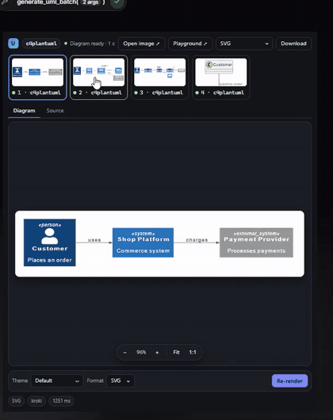

# MCP App viewer

UML-MCP serves an interactive viewer as an [MCP App](https://modelcontextprotocol.io/) at
`ui://uml-mcp/diagram-viewer` (`text/html;profile=mcp-app`). Clients that support MCP Apps open
it inside the chat when `generate_uml`, `generate_uml_image` or `generate_uml_batch` returns.

<video controls preload="metadata" poster="../assets/mcp-app-demo.png" width="480">
  <source src="../assets/mcp-app-demo.mp4" type="video/mp4">
  
</video>

*One `generate_uml_batch` call returns four C4 and class diagrams as tabs, then one is
re-rendered in another format (14 s).*

## What it does

| Feature | Details |
| --- | --- |
| View | Zoom, pan, fit and 1:1; a gallery when a batch returns several diagrams |
| Edit | The Source tab shows the diagram source; edit it and re-render |
| Re-render | Pick a theme and a format; for plugin types the theme is written into the source |
| Export | SVG, PNG, HTML and, for types that render SVG, PDF, through the host's download bridge |
| Interactive pages | Plugin types (D3, stack diagram, archify, LLM visualizer) open their HTML page in a sandboxed frame |

## Interactive plugin pages

A plugin's HTML page runs in an `iframe` with `sandbox="allow-scripts"`, under the page's own
hash-based Content-Security-Policy, with no network access. Inside the viewer the page keeps only
a slim title and toolbar, since the viewer has its own header. In the archify and stack-diagram
pages you can:

- click a node to focus it: everything not connected to it dims and a panel on the right lists
  its group, tags, reach and links;
- shift-click a second node to trace the shortest path between them, highlighted, with each step
  and its edge label;
- switch the preset (archify), animate the edges with **Live**, and toggle light and dark.

## Clients without MCP Apps

Nothing depends on the viewer. `generate_uml_image` returns an inline PNG (a compact preview for
large diagrams), `generate_uml` returns SVG, and every result carries the rendered image's URL and,
where the notation has one, an editable playground link.

## Publishing readiness

The mirror (`https://uml-mcp.antoineboucher.info/mcp`) was checked with the
[Manufact](https://manufact.com) publishing checklist on October 30, 2026: **95/100**, 30 checks
passed and 1 warning, ready for ChatGPT and Claude.

| Area | Result | What was checked |
| --- | --- | --- |
| Protocol | 4/4 | Negotiation (v1 and v2), `tools/list`, `resources/list`, tools capability |
| Tools | 12/12 | Descriptions and titles, names, OpenAI behaviour hints, schemas, a readable tool-linked `ui://` resource, invocation metadata |
| MCP Apps | 6/7 | MIME type, one HTTPS domain, CSP covering every external origin, no nested frames. The warning asked for a view description in `_meta`; the resource now sends `_meta["openai/widgetDescription"]` on its contents, to be confirmed on the next run |
| Client compatibility | 8/8 | Skills over MCP, Claude Code field sizes, Claude name length and hints, Cursor name budget, ChatGPT unique names, file parameters |
| Policy review | partial | The platform's review agent did not finish; this is a platform step, not a server setting |

Deployment details, the viewer origin (`MCP_APP_DOMAIN`) and payload limits are in
[MCP Apps compatibility](manufact-compatibility.md).
