# Plugins

Ten bundled plugins provide 15 interactive diagram types. Browse their previews
below, or [open the local viewer](../integrations/mcp-app.md#local-viewer-preview)
to try them with live controls.

## Interactive diagram gallery

All 15 types render to interactive HTML and static SVG. UML-MCP also rasterizes
SVG to PNG for chat images and downloads. Each preview links to its plugin guide.

[Open the local viewer instructions](../integrations/mcp-app.md#local-viewer-preview).
The compact example picker switches diagrams automatically in the viewer toolbar.

<div class="grid cards plugin-gallery" markdown>

-   [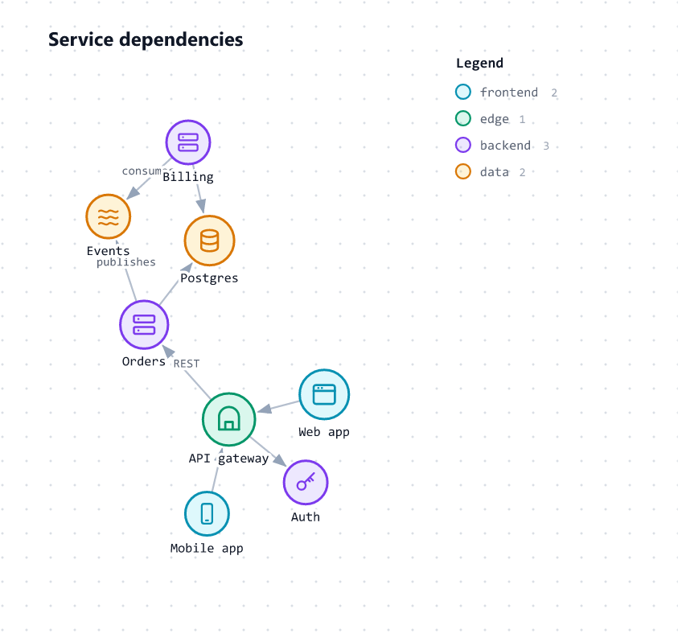](d3.md)

    [`d3_force`](d3.md)

-   [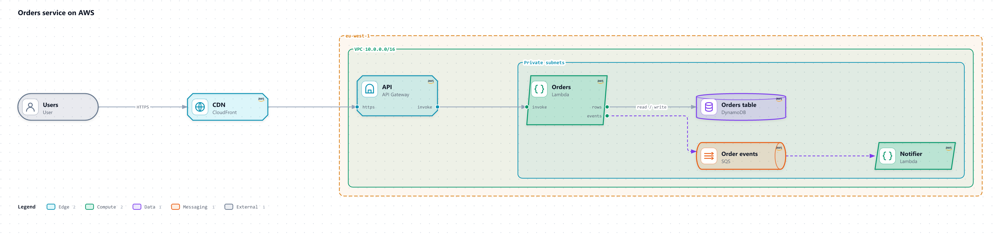](d3.md)

    [`d3_architecture`](d3.md)

-   [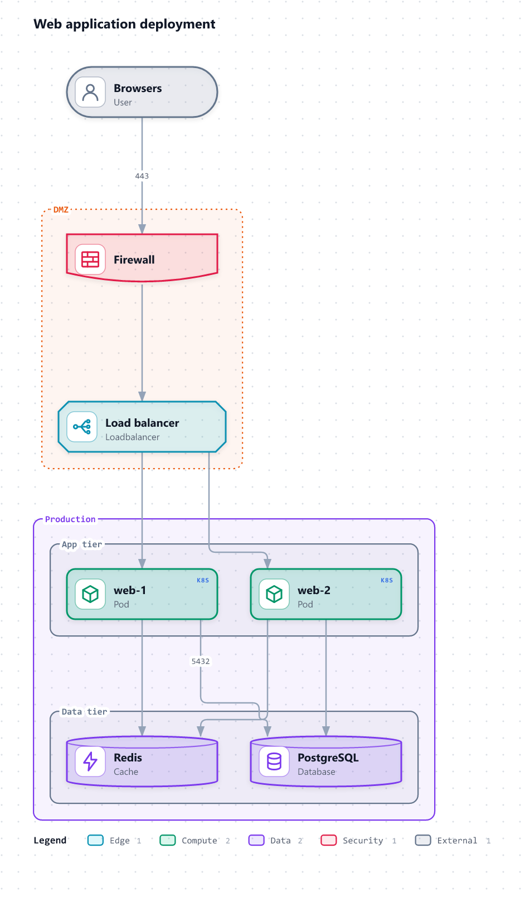](d3.md)

    [`d3_topology`](d3.md)

-   [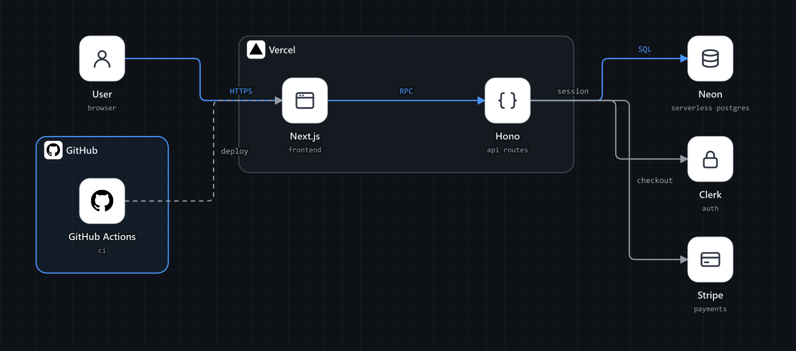](stack-diagram.md)

    [`stack_diagram`](stack-diagram.md)

-   [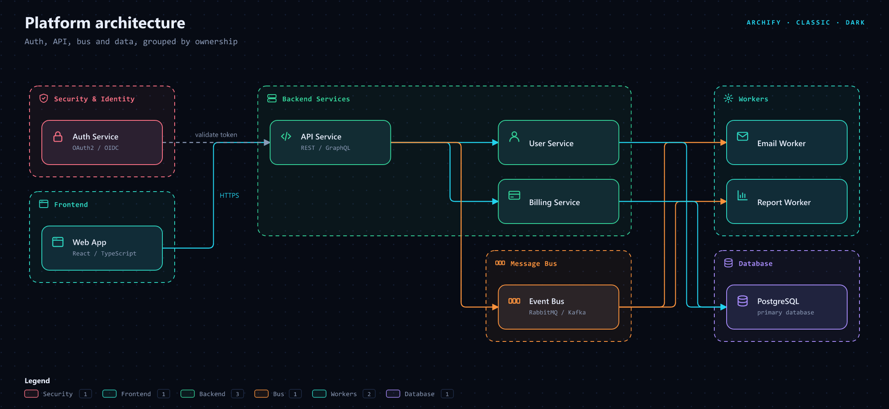](archify.md)

    [`archify_architecture`](archify.md)

-   [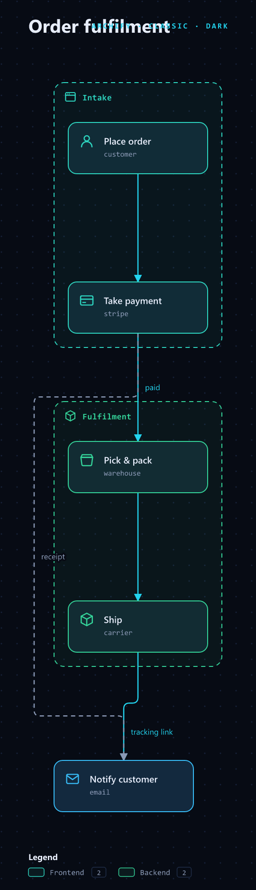](archify.md)

    [`archify_workflow`](archify.md)

-   [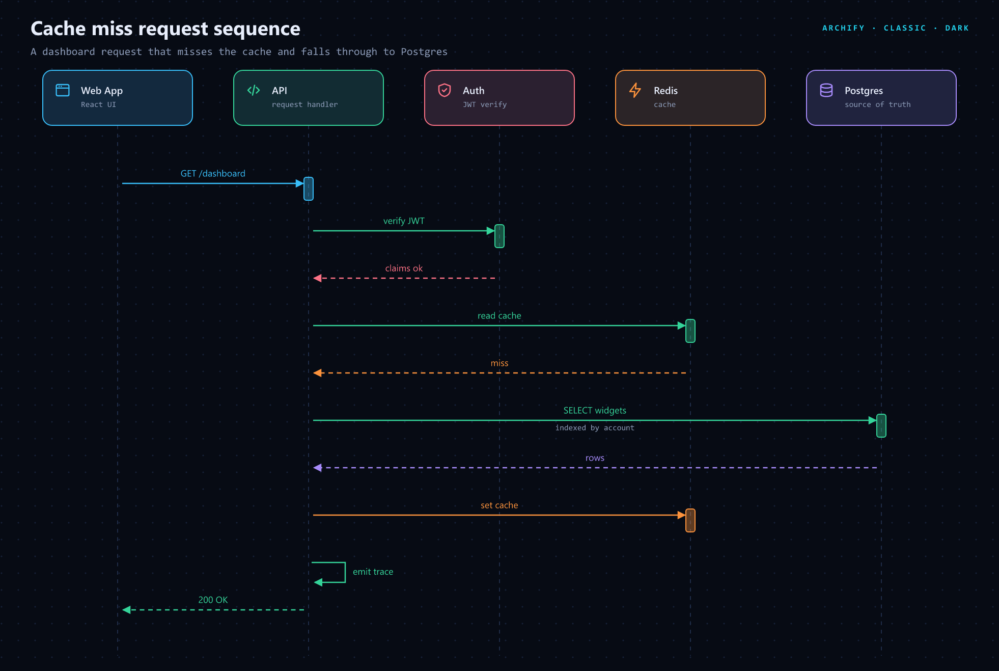](archify.md)

    [`archify_sequence`](archify.md)

-   [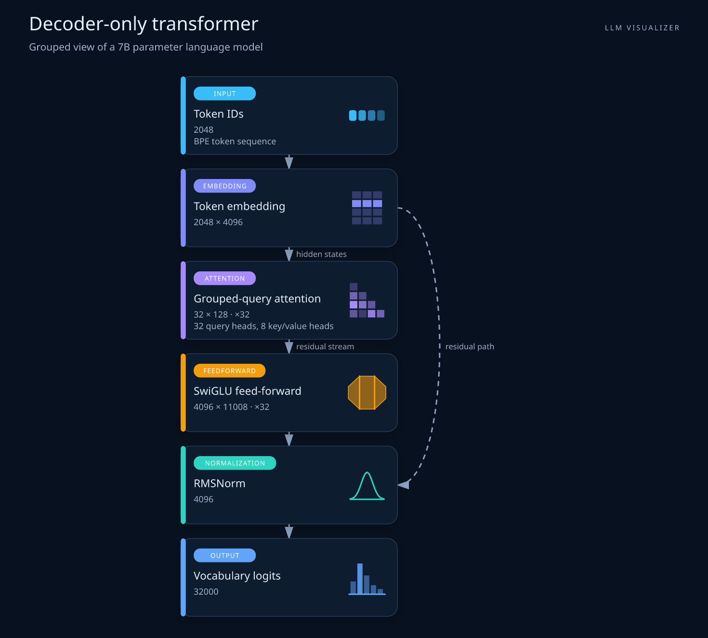](llm-visualizer.md)

    [`llm_2d`](llm-visualizer.md)

-   [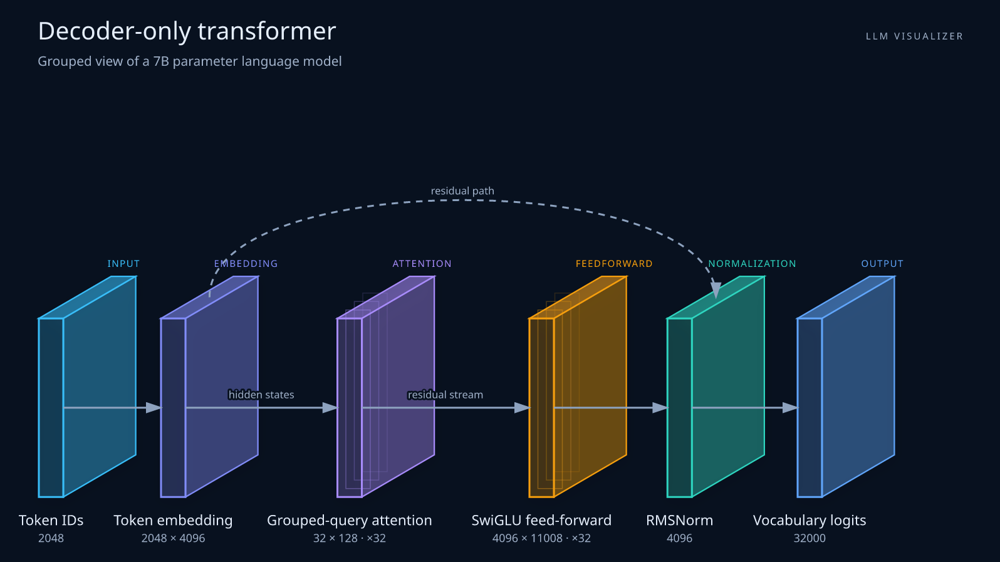](llm-visualizer.md)

    [`llm_3d`](llm-visualizer.md)

-   [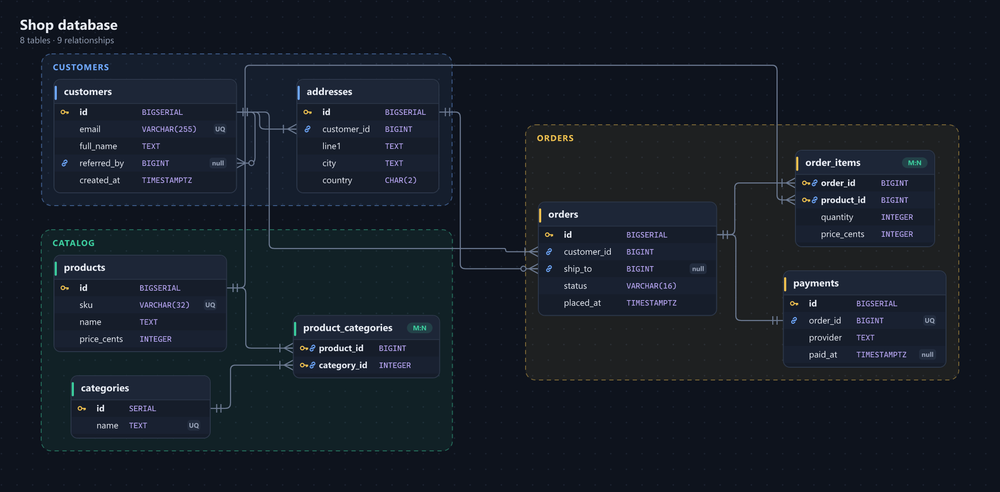](schema.md)

    [`db_schema`](schema.md)

-   [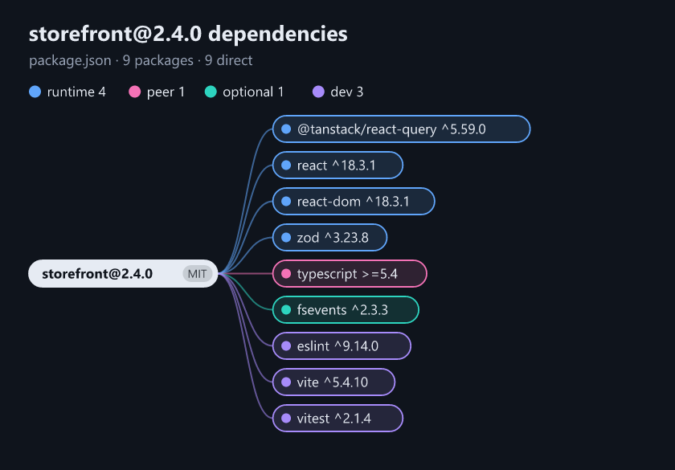](deps.md)

    [`dependency_graph`](deps.md)

-   [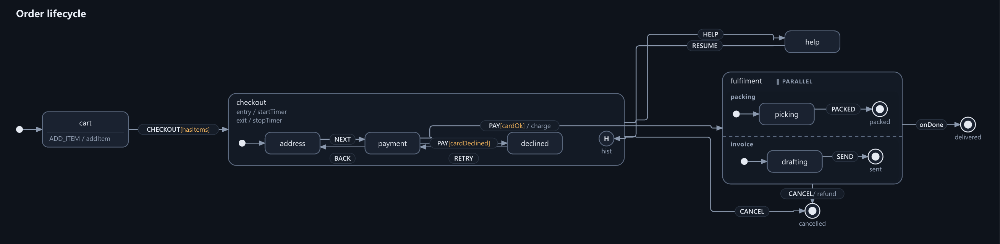](statechart.md)

    [`state_machine`](statechart.md)

-   [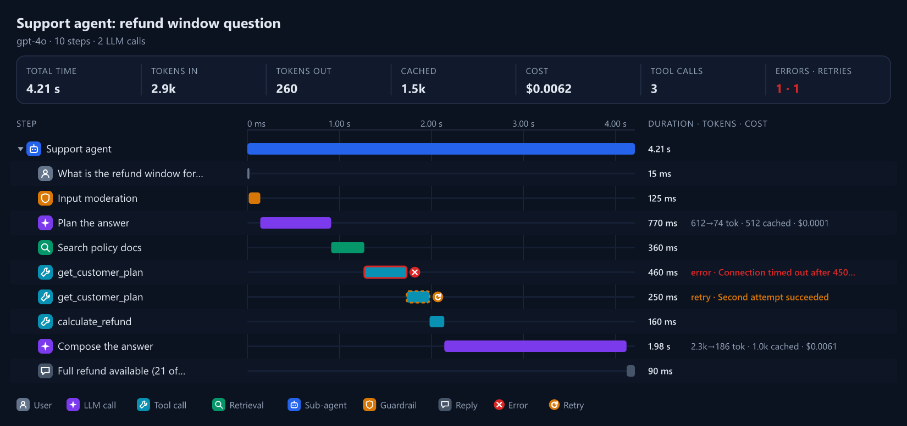](trace.md)

    [`agent_trace`](trace.md)

-   [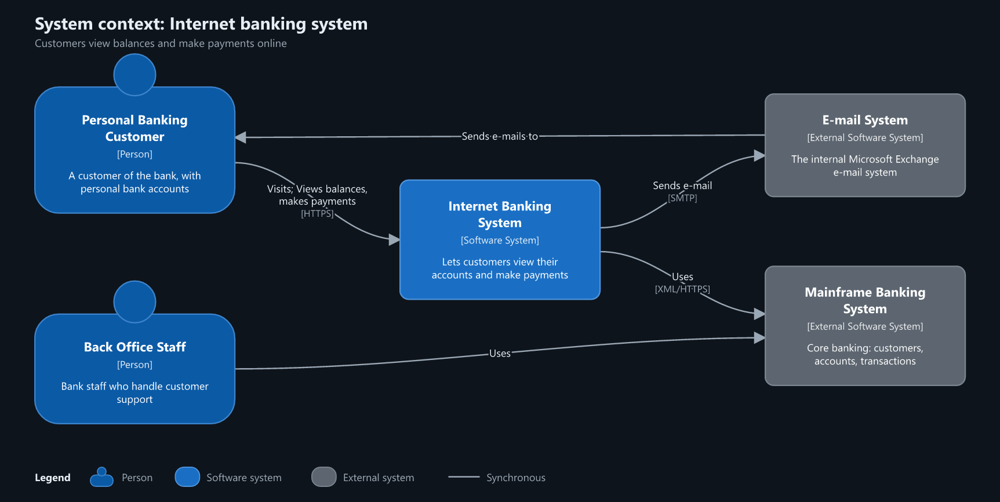](c4.md)

    [`c4_model`](c4.md)

-   [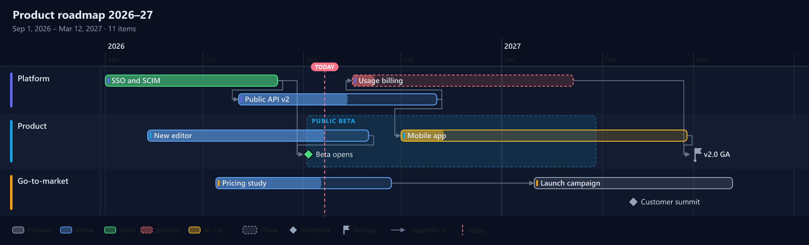](timeline.md)

    [`timeline`](timeline.md)

</div>

## Plugin tools and renderers

Plugins add capabilities without forking UML-MCP:

| Kind | Entry-point group | Adds |
| --- | --- | --- |
| **Tools** | `uml_mcp.tools` | New MCP tools, named `<plugin>_<tool>` |
| **Renderers** | `uml_mcp.renderers` | New diagram types, rendered locally before Kroki, as images or as an interactive HTML page |

Plugin tools get everything the built-in tools get:

- the audit trail, metrics and OpenTelemetry spans
- rate limits and `tools.enabled`/`disabled`
- `uml-mcp lint`
- enterprise read/write authorization, from `readOnlyHint`

Plugin diagram types appear in `list_diagram_types`, `uml://types`, validation and
the console.

## Install and enable

Plugins are ordinary Python packages installed in the same environment:

```bash
uv tool install uml-mcp --with uml-mcp-plugin-hello     # or: pip install uml-mcp-plugin-hello
uml-mcp plugins list
uml-mcp plugins enable hello        # the tool plugin
uml-mcp plugins enable ascii        # the renderer plugin
```

Restart the server after changing plugin configuration. Ten renderers ship with
UML-MCP and load by default through `plugins.bundled: true`:

`d3`, `stack-diagram`, `archify`, `llm-visualizer`, `schema`, `deps`, `statechart`,
`trace`, `c4` and `timeline`.

Extra plugin tools, such as `d3_catalog`, require an entry in `plugins.enabled`.
Other installed plugins also require that allow-list. Setting `bundled: false`
turns off automatic renderer loading; list every renderer you want to keep.
One entry-point name can enable both tools and a renderer.

```yaml
# uml-mcp.yaml
plugins:
  enabled: [hello, ascii]
  settings:
    hello: {greeting: "Hi"}          # passed to the plugin
```

The console's **Tools & plugins** page lists installed plugins, their status, and any load
error, with an enable/disable switch.

## Plugin diagrams open as an MCP App

In clients with MCP Apps, a plugin's HTML page opens in the viewer inside the chat; everywhere
else the same type renders to SVG and PNG. See the [MCP App viewer](../integrations/mcp-app.md)
for what the pages can do and a recording.

## Plugins in this repository

The ten interactive plugins listed below ship inside the `uml-mcp` package and
load by default. Their source is under `examples/plugins`. The `hello` and `ascii`
examples require a separate installation; the explicitly positioned `architecture`
renderer is experimental and off by default.

| Plugin | Enable | Adds |
| --- | --- | --- |
| `uml-mcp-plugin-hello` | `hello`, `ascii` | The `hello_echo` tool and an `ascii` diagram type: the smallest complete example |
| `uml-mcp-plugin-d3` | `d3` | Interactive `d3_force`, `d3_architecture` and `d3_topology` diagrams (HTML or SVG), and the `d3_catalog` tool. See the [D3 diagrams plugin](d3.md) |
| `uml-mcp-plugin-stack-diagram` | `stack-diagram` | The auto-laid-out `stack_diagram` type: icon tiles, nested groups, left-right or top-down, dark or light. See the [stack diagram plugin](stack-diagram.md) |
| `uml-mcp-plugin-archify` | `archify` | `archify_architecture`, `archify_workflow` and `archify_sequence`: dashed colour-coded groups, icon cards, presets and click-to-focus pages, sharing the stack-diagram engine. See the [archify plugin](archify.md) |
| `uml-mcp-plugin-llm-visualizer` | `llm-visualizer` | Interactive `llm_2d` and `llm_3d` LLM architecture diagrams (HTML or SVG). See the [LLM visualizer plugin](llm-visualizer.md) |
| `uml-mcp-plugin-schema` | `schema` | `db_schema`: database schema (ER) diagrams from SQL DDL or JSON, with crow's-foot relationships at the column rows (HTML or SVG). See the [database schema plugin](schema.md) |
| `uml-mcp-plugin-deps` | `deps` | `dependency_graph`: a project's dependency tree from `package.json`, `package-lock.json`, `pyproject.toml`, `requirements.txt` or `uv.lock` (HTML or SVG). See the [dependency graph plugin](deps.md) |
| `uml-mcp-plugin-statechart` | `statechart` | The `state_machine` type: XState-like JSON drawn as a statechart, and an HTML simulator that fires events, highlights the active states and keeps an undoable step log. See the [statechart plugin](statechart.md) |
| `uml-mcp-plugin-trace` | `trace` | The `agent_trace` type: an agent run as a waterfall of LLM, tool, retrieval and sub-agent steps with tokens, cost, errors and retries, plus a flow view and the critical path (HTML or SVG). See the [agent trace plugin](trace.md) |
| `uml-mcp-plugin-c4` | `c4` | `c4_model`: one JSON model of people, systems, containers and components, drawn in C4 notation (SVG) or as a page that drills from context to containers to components (HTML). See the [C4 model plugin](c4.md) |
| `uml-mcp-plugin-timeline` | `timeline` | The `timeline` type: swimlanes, task bars with progress and status, phases, milestones, releases and dependencies, on a page that zooms from quarters to days. See the [timeline plugin](timeline.md) |
| built in (`mcp_core.plugins.architecture`) | `architecture` | Experimental, off by default: tiles at explicit positions, exported as HTML or React TSX. See [architecture diagrams](architecture.md) |

## Shared options

`stack-diagram` and `archify` share one auto-layout engine and source format:

| Option | Values | Notes |
| --- | --- | --- |
| `direction` | `LR` · `RL` · `TB` · `BT` | Flow direction; `LR` by default, `archify_workflow` starts top down |
| `theme` | `auto` · `dark` · `light` | `auto` (default) follows the system in HTML and is dark in static output; the viewer's theme picker sets it |
| `groups` | nested with `parent` | A group box encloses exactly its members |
| `icon` | brand, glyph or data URI | 60 real logos (GitHub, Vercel, AWS, Azure, Google Cloud, OpenAI, Claude, Gemini, Qwen, LangGraph, Snowflake...), also guessed from a node's name; 25 line glyphs; or your own image |
| `step` (edges) | `1` to `999` | A numbered badge for request paths and journeys |

## Try these prompts

| Ask | Type |
| --- | --- |
| *"Draw my stack: Next.js and Hono on Vercel, Neon Postgres, Clerk for auth, Stripe for payments. Left to right, light theme."* | `stack_diagram` |
| *"Show our platform as an archify architecture with security, backend and database groups, blueprint preset."* | `archify_architecture` |
| *"Numbered sequence diagram of a cache-miss request through web, API, auth, Redis and Postgres."* | `archify_sequence` |
| *"Our AI app: Cloudflare in front of a Vercel app, a LangChain agent calling Claude, OpenAI and Gemini."* | `d3_architecture` |
| *"Draw an autoencoder top-down, then the same model as a 3D scene."* | `llm_2d` · `llm_3d` |
| *"A transformer with encoder and decoder blocks repeated 6 times."* | `llm_2d` with groups |
| *"Draw the schema of this CREATE TABLE script, grouped by billing and catalog."* | `db_schema` |
| *"Show this project's dependency tree from its uv.lock."* | `dependency_graph` |
| *"Show this agent run as a trace: a retrieval, two tool calls (one retried) and the reply, with tokens and cost."* | `agent_trace` |
| *"Model checkout as a statechart with payment, cancellation and an Undo-able simulation."* | `state_machine` |
| *"Draw a C4 model with systems, containers and components that I can drill into."* | `c4_model` |
| *"Show our release roadmap with swimlanes, milestones and dependencies."* | `timeline` |

Each type also has an agent skill with a validated example, at
`.skill/skills/<diagram_type>/SKILL.md`, and each plugin family a focused guide read over MCP from
`skill://uml-mcp-guides/{topic}/SKILL.md`. To check a deployment end to end, paste the
complete [15-type smoke prompt](https://github.com/antoinebou12/uml-mcp/blob/main/tests/prompts/all_interactive_plugins_smoke_test.md)
into any MCP client.

## Safety

- **Trusted code:** plugins run in the server process with its permissions. Install only
  packages you trust, and pin their versions.
- **Opt-in loading:** nothing loads unless allow-listed, except the bundled first-party
  renderers (only from the `uml-mcp` distribution itself; `plugins.bundled: false` turns them off). A plugin that fails to load is
  marked with its error, and the server still starts.
- **Collisions:** built-in diagram types can't be overridden, and duplicate tool names
  are rejected.
- **Output formats:** a type accepts only the formats it declares. `html` is accepted by
  plugin types that list it and refused for every built-in type.
- **Cost:** every plugin tool and diagram type is part of what a client loads when it
  connects, in every conversation. Extra tools increase the connection-time catalog. Use `uml-mcp lint` with your
  actual configuration to measure that cost. The default CI token budget checks the
  bundled renderers with extra tools disabled.
- **Lint:** `uml-mcp lint` reports PLG001 for an enabled plugin that isn't installed, and
  PLG002 for one that failed to load.
- **Enterprise:** plugin tools without `readOnlyHint: true` need the **write** scope.

## Write one

Follow the [plugin author guide](authoring.md). A larger example, with an HTML renderer,
custom validation, settings and browser tests, is the [D3 diagrams plugin](d3.md). The smallest lives in
[`examples/plugins/uml-mcp-plugin-hello`](https://github.com/antoinebou12/uml-mcp/tree/main/examples/plugins/uml-mcp-plugin-hello).
