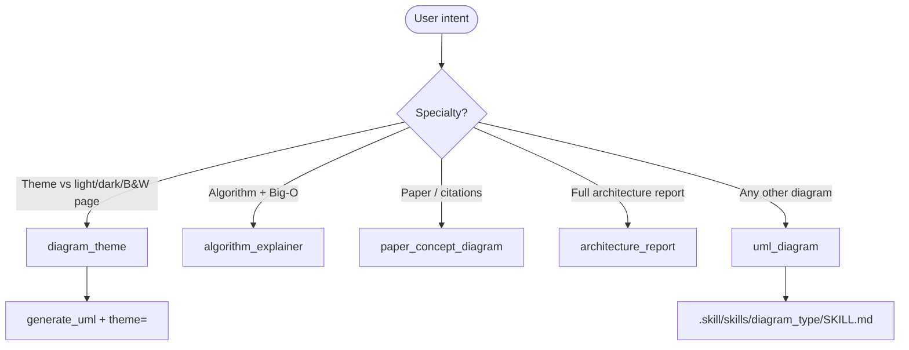

# MCP prompts

Prompts are named text templates an MCP client can fetch with `prompts/get` and pass into the model context. UML-MCP publishes **five** prompts on `prompts/list`. Per-type notation (class, sequence, mermaid, …) lives in agent skills under `.skill/skills/<diagram_type>/SKILL.md`, not as extra MCP prompts, so connect-time stays small.

Source of truth: [`mcp_core/prompts/diagram_prompts.py`](https://github.com/antoinebou12/uml-mcp/blob/main/mcp_core/prompts/diagram_prompts.py).

## Calling a prompt

```json
{
  "jsonrpc": "2.0",
  "id": 1,
  "method": "prompts/get",
  "params": {
    "name": "uml_diagram",
    "arguments": { "context": "{\"diagram_type\": \"sequence\"}" }
  }
}
```

Every published prompt accepts an optional `context` string carrying a JSON object. Common keys: `diagram_type`, `thinking` (`false` skips the plan preamble on `uml_diagram`), `background` / `bg` (`light`, `dark`/`black`, `bw`/`print` for `diagram_theme`), `algorithm`, `paper`, `subject` / `repository`.

## Published prompts

| Prompt | Purpose |
| --- | --- |
| `uml_diagram` | Plan-then-generate any catalog `diagram_type` (PlantUML, Mermaid, D2, …), with layout tips. Prefer this for general diagrams. |
| `diagram_theme` | Pick a `generate_uml` `theme` for **light**, **dark/black**, or **B&W/print** page backgrounds (PlantUML / Mermaid / D2). |
| `algorithm_explainer` | Algorithm diagrams with Big-O labels; pairs with [`uml://recipes`](resources.md) key `algorithm_flowchart`. |
| `paper_concept_diagram` | Paper/concept diagrams with clickable citations (prefer SVG); pairs with `uml://recipes` key `paper_concept`. |
| `architecture_report` | Numbered Markdown architecture report with several `generate_uml` renders and a linked TOC. |

## Per-type notation (agent skills, not MCP prompts)

Load `.skill/skills/<diagram_type>/SKILL.md` (or the [agent-skills index](https://github.com/antoinebou12/uml-mcp/blob/main/.well-known/agent-skills/index.json)) for starters and samples. Former MCP names such as `class_diagram`, `sequence_diagram`, `mermaid_sequence_api`, `bpmn_executable_process`, and `c4_model` are unpublished helpers only.

[:octicons-arrow-right-24: Diagram skill over MCP](resources.md#diagram-skill-over-mcp)

[:octicons-arrow-right-24: Per-type agent skills](resources.md#per-type-agent-skills)

## Choosing the right entry



## `diagram_theme`

Use when the chat UI or document has a **white**, **black/dark**, or **black-and-white/print** background and you need a matching PlantUML / Mermaid / D2 `theme`.

```json
{
  "jsonrpc": "2.0",
  "id": 2,
  "method": "prompts/get",
  "params": {
    "name": "diagram_theme",
    "arguments": {
      "context": "{\"background\": \"bw\", \"diagram_type\": \"class\"}"
    }
  }
}
```

| `background` | Typical PlantUML `theme` | Mermaid | D2 |
| --- | --- | --- | --- |
| `light` / `white` | `cerulean`, `materia`, `sketchy` | `forest`, `default` | `default` |
| `dark` / `black` | `blueprint`, `cyborg`, `black-knight` | `dark` | `dark` |
| `bw` / `print` / `mono` | `plain`, `sketchy`, `mimeograph` | `neutral`, `base` | `default` |

## `architecture_report`

Produces a numbered Markdown architecture report of a repository, with a linked table of contents and sections for introduction, I/O, use case, sequence, class, activity, deployment, user flow, inventory, risks, and references. Each diagram section should call `validate_uml` then `generate_uml` and embed the returned URL / playground.

## Workflow tip

All diagram prompts end by instructing the model to call `generate_uml` (or `generate_uml_image` / `generate_uml_batch`) with the right `diagram_type`. Combined with `uml://workflow` and the [workflow skill](https://github.com/antoinebou12/uml-mcp/blob/main/.skill/skills/uml-mcp-diagrams/SKILL.md), you get plan → code → render in a single MCP turn.
